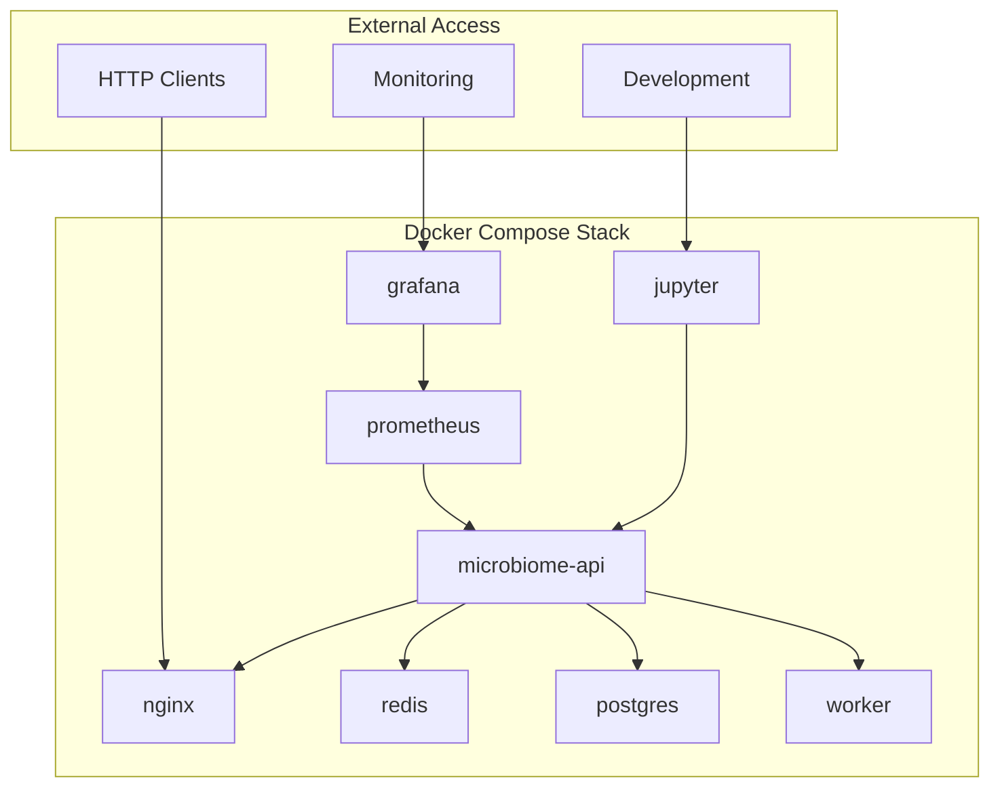

# Docker Deployment

This guide covers deploying the Microbiome Term Extraction Pipeline using Docker and Docker Compose for production environments.

## 🐳 Prerequisites

- Docker Engine 20.10+
- Docker Compose 2.0+
- At least 8GB RAM
- At least 10GB disk space

## 🚀 Quick Start

### Using Docker Compose (Recommended)

```bash
# Clone the repository
git clone https://github.com/your-org/microbiome-pipeline.git
cd microbiome-pipeline

# Start all services
docker-compose up -d

# Check status
docker-compose ps

# View logs
docker-compose logs -f microbiome-api
```

The pipeline will be available at:
- **API**: http://localhost:8000
- **API Documentation**: http://localhost:8000/docs
- **Grafana**: http://localhost:3000 (admin/REDACTED_PASSWORD)
- **Prometheus**: http://localhost:9090

### Using Docker directly

```bash
# Build the image
docker build -t microbiome-pipeline:latest .

# Run the container
docker run -d \
  --name microbiome-api \
  -p 8000:8000 \
  -v $(pwd)/data:/app/data \
  -v $(pwd)/logs:/app/logs \
  microbiome-pipeline:latest
```

## 📋 Service Architecture

The Docker Compose setup includes multiple services:



### Core Services

| Service | Description | Port | Resources |
|---------|-------------|------|-----------|
| **microbiome-api** | Main FastAPI application | 8000 | 2 CPU, 4GB RAM |
| **worker** | Background job processing | - | 1 CPU, 2GB RAM |
| **nginx** | Reverse proxy & load balancer | 80, 443 | 0.5 CPU, 512MB RAM |
| **redis** | Caching & job queue | 6379 | 0.5 CPU, 512MB RAM |
| **postgres** | Persistent storage | 5432 | 1 CPU, 2GB RAM |

### Monitoring Services

| Service | Description | Port | Resources |
|---------|-------------|------|-----------|
| **prometheus** | Metrics collection | 9090 | 1 CPU, 2GB RAM |
| **grafana** | Visualization dashboard | 3000 | 0.5 CPU, 512MB RAM |
| **jupyter** | Development environment | 8888 | 2 CPU, 4GB RAM |

## ⚙️ Configuration

### Environment Variables

Create a `.env` file for custom configuration:

```bash
# API Configuration
API_HOST=0.0.0.0
API_PORT=8000
WORKERS=4
LOG_LEVEL=INFO

# Database Configuration
POSTGRES_DB=microbiome_pipeline
POSTGRES_USER=pipeline_user
POSTGRES_PASSWORD=your_secure_password

# Redis Configuration
REDIS_URL=redis://redis:6379/0

# Monitoring
PROMETHEUS_ENABLED=true
GRAFANA_ADMIN_PASSWORD=your_admin_password

# Security
API_KEY=your_api_key_here
```

### Custom Docker Compose Override

Create `docker-compose.override.yml` for custom configurations:

```yaml
version: '3.8'

services:
  microbiome-api:
    build:
      target: development  # Use development stage
    volumes:
      - ./:/app  # Mount source code
      - /app/data  # Exclude data mount
    environment:
      - DEBUG=true
      - LOG_LEVEL=DEBUG
    command: ["uvicorn", "api:app", "--host", "0.0.0.0", "--port", "8000", "--reload"]

  worker:
    build:
      target: development
    volumes:
      - ./:/app
    environment:
      - DEBUG=true
```

## 🔧 Production Deployment

### Production Dockerfile

The Dockerfile includes multi-stage builds for optimized production deployment:

```dockerfile
# Production stage
FROM python:3.11-slim as production

# Security configurations
RUN groupadd -r pipeline && useradd -r -g pipeline pipeline

# Minimal runtime dependencies
RUN apt-get update && apt-get install -y \
    curl \
    ca-certificates \
    && rm -rf /var/lib/apt/lists/* \
    && apt-get clean

# Copy application
COPY --from=builder /opt/venv /opt/venv
COPY --chown=pipeline:pipeline . .

# Security: Run as non-root user
USER pipeline

# Health check
HEALTHCHECK --interval=30s --timeout=30s --start-period=5s --retries=3 \
    CMD curl -f http://localhost:8000/health || exit 1

# Production-ready server
CMD ["gunicorn", "--bind", "0.0.0.0:8000", "--workers", "4", "--worker-class", "uvicorn.workers.UvicornWorker", "api:app"]
```

### Scaling Services

#### Horizontal Scaling

```bash
# Scale API services
docker-compose up -d --scale microbiome-api=3

# Scale worker services
docker-compose up -d --scale worker=2
```

#### Resource Limits

```yaml
version: '3.8'

services:
  microbiome-api:
    deploy:
      resources:
        limits:
          cpus: '2.0'
          memory: 4G
        reservations:
          cpus: '1.0'
          memory: 2G
      restart_policy:
        condition: on-failure
        max_attempts: 3
```

## 🔒 Security Best Practices

### 1. Network Security

```yaml
# Only expose necessary ports
services:
  microbiome-api:
    ports:
      - "8000:8000"
    networks:
      - frontend
      - backend

  postgres:
    ports: []  # Don't expose externally
    networks:
      - backend
```

### 2. Secrets Management

```yaml
# Use Docker secrets
version: '3.8'

services:
  microbiome-api:
    secrets:
      - api_key
      - db_password

secrets:
  api_key:
    external: true
  db_password:
    external: true
```

### 3. Read-only Filesystem

```yaml
services:
  microbiome-api:
    read_only: true
    tmpfs:
      - /tmp
      - /app/logs
      - /app/temp
```

### 4. Health Checks

```yaml
services:
  microbiome-api:
    healthcheck:
      test: ["CMD", "curl", "-f", "http://localhost:8000/health"]
      interval: 30s
      timeout: 10s
      retries: 3
      start_period: 40s
```

## 📊 Monitoring and Logging

### Prometheus Metrics

The pipeline exposes metrics at `/metrics`:

```bash
# Check metrics
curl http://localhost:8000/metrics

# Key metrics
pipeline_requests_total
pipeline_request_duration_seconds
pipeline_active_jobs
pipeline_processing_time_seconds
```

### Log Aggregation

```yaml
# ELK Stack integration
version: '3.8'

services:
  elasticsearch:
    image: docker.elastic.co/elasticsearch/elasticsearch:8.5.0
    environment:
      - discovery.type=single-node

  logstash:
    image: docker.elastic.co/logstash/logstash:8.5.0
    volumes:
      - ./logstash.conf:/usr/share/logstash/pipeline/logstash.conf

  kibana:
    image: docker.elastic.co/kibana/kibana:8.5.0
    ports:
      - "5601:5601"
```

### Custom Health Checks

```python
# Custom health check endpoint
@app.get("/health/detailed")
async def detailed_health():
    return {
        "status": "healthy",
        "timestamp": datetime.now(),
        "services": {
            "database": await check_database(),
            "redis": await check_redis(),
            "models": await check_models()
        }
    }
```

## 🔄 CI/CD Integration

### GitHub Actions

```yaml
name: Deploy to Production

on:
  push:
    branches: [main]

jobs:
  deploy:
    runs-on: ubuntu-latest
    steps:
      - uses: actions/checkout@v3

      - name: Build Docker image
        run: |
          docker build -t microbiome-pipeline:${{ github.sha }} .
          docker tag microbiome-pipeline:${{ github.sha }} microbiome-pipeline:latest

      - name: Deploy to production
        run: |
          docker-compose -f docker-compose.prod.yml up -d
```

### Deployment Script

```bash
#!/bin/bash
# deploy.sh

set -e

echo "Deploying Microbiome Pipeline..."

# Pull latest changes
git pull origin main

# Build new image
docker-compose build

# Run database migrations
docker-compose exec microbiome-api python -m alembic upgrade head

# Zero-downtime deployment
docker-compose up -d --no-deps microbiome-api

# Wait for health check
sleep 30

# Verify deployment
curl -f http://localhost:8000/health || exit 1

echo "Deployment successful!"
```

## 🐛 Troubleshooting

### Common Issues

#### 1. Container Won't Start

```bash
# Check logs
docker-compose logs microbiome-api

# Check container status
docker-compose ps

# Inspect container
docker inspect microbiome-api
```

#### 2. Memory Issues

```bash
# Check memory usage
docker stats

# Increase memory limits
docker-compose up -d --scale microbiome-api=1
```

#### 3. Model Loading Failures

```bash
# Check model files
docker-compose exec microbiome-api ls -la /opt/venv/lib/python*/site-packages/en_ner_bc5cdr_md/

# Rebuild with models
docker-compose build --no-cache microbiome-api
```

#### 4. Database Connection Issues

```bash
# Test database connection
docker-compose exec postgres psql -U pipeline_user -d microbiome_pipeline -c "SELECT 1;"

# Check network
docker network ls
docker network inspect microbiome-pipeline_microbiome-network
```

### Performance Tuning

#### 1. Optimize Build Time

```dockerfile
# Use .dockerignore effectively
COPY requirements.txt .
RUN pip install -r requirements.txt

# Copy only necessary files
COPY src/ ./src/
COPY main.py .
COPY api.py .
```

#### 2. Reduce Image Size

```dockerfile
# Use Alpine Linux for smaller images
FROM python:3.11-alpine

# Remove unnecessary packages
RUN apk del --purge \
    build-base \
    && rm -rf /var/cache/apk/*
```

#### 3. Optimize Runtime Performance

```yaml
# Use appropriate resource limits
services:
  microbiome-api:
    deploy:
      resources:
        limits:
          cpus: '2.0'
          memory: 4G
    environment:
      - WORKERS=4
      - MAX_REQUESTS=1000
      - WORKER_CONNECTIONS=1000
```

## 📚 Advanced Topics

### Multi-Environment Deployment

```bash
# Development
docker-compose -f docker-compose.yml -f docker-compose.dev.yml up -d

# Staging
docker-compose -f docker-compose.yml -f docker-compose.staging.yml up -d

# Production
docker-compose -f docker-compose.yml -f docker-compose.prod.yml up -d
```

### Blue-Green Deployment

```bash
# Deploy to blue environment
docker-compose -p blue up -d

# Test blue environment
curl http://localhost:8001/health

# Switch traffic to blue
# Update load balancer configuration

# Deploy to green environment
docker-compose -p green up -d
```

### Canary Deployments

```bash
# Deploy canary with 10% traffic
docker-compose up -d --scale microbiome-api=9
docker-compose -p canary up -d --scale microbiome-api=1

# Configure load balancer for 10% traffic to canary
```

This comprehensive Docker deployment guide provides everything needed to deploy the Microbiome Term Extraction Pipeline in production environments with scalability, security, and monitoring considerations.