# Microbiome-CDM: pipeline, results and every number (2026-11-10)

*One file combining `docs/reports/pipeline_flowchart.md` (rev 3), `paper/publication/submission_readiness/RESULTS_REFERENCE_2026-11-06.md` and the full claims register, plus the 2026-11-08/09 work. Generated by `src/scripts/final_validation/build_pipeline_and_numbers.py`; the parts are copied, not rewritten. **Reference notes for the authors, not manuscript text.** No human annotation was done [H01]; nothing here is accuracy unless it is F1 on a public gold standard.*

## Contents

1. Frozen set and verification status
2. Pipeline flowchart (rev 3, with diagram and stage index)
3. Results reference: what we did and what we got
4. Work after the flowchart (2026-11-08 / 09)
5. Every registered number (claims register)
6. Numbers that are not register rows, and how each was checked
7. Open before submission

## Part 1. Frozen set and verification status

| Component | Version | Location | Integrity (checked 2026-11-08/09) |
|---|---|---|---|
| Corpus | 2.2.0 (453 papers, 447 publications, 4,006 sections) | `pipelines/corpus_v2/releases/2.2.0` (+ segmented, markdown, per-model NER in `releases/frozen_output/01_corpus`, `04_ner`) | own MANIFEST OK |
| Terminology | 1.0.1 | `releases/terminology/1.0.1` | MANIFEST OK |
| Data catalogue | 3.1.1 | `releases/data_catalogue_v3/3.1.1` | MANIFEST OK |
| CDM | 3.0.3 (44 tables, 8,490,496 rows) | `releases/cdm_v3/3.0.3/microbiome_cdm_v3.db` | sha256 5d23ba87…; MANIFEST OK |
| Index of the set | — | `releases/CURRENT_FROZEN_SET_2026-11-02/` | 17 release manifests OK |
| Validation outputs | frozen 2026-11-02 | `paper/publication/final_validation/` | FINAL_VALIDATION_MANIFEST.sha256: 119 / 119 OK |
| Claims register | 170 rows (146 MATCH, 1 STATEMENT) | `final_validation/MANUSCRIPT_CLAIMS_REGISTER.csv` | sha256 f986f2b2718311ec…; versioned via CHANGE_RECORD.md |
| Data audit | 2026-11-09 | `final_validation/review_2026-11-09/data_audit/` | 38 / 38 PASS |

Status labels used below: **[ID]** = register row, recomputed from the frozen data (MATCH); **AUDIT** = re-derived from frozen artefacts by the 2026-11-09 audit; **REPORT** = stated in a frozen validation report under FINAL_VALIDATION_MANIFEST; **RUN** = dated result file; **DERIVED** = arithmetic on register rows; **DO_NOT_CITE**.

Do not mix builds: CDM 3.0.3 (25,788 triples, 52,400 catalogue records) vs the v2-era CDM in `frozen_output/03_common_data_model` (110,981 entities, 24,910 co-occurrence relationships) and the v2-era catalogue (56,985 records). Corpus 2.2.0 holds 32,713 corpus-stage canonical triples, before the stage-56 gate that leaves the 25,788 in the CDM.

## Part 2. Pipeline flowchart (rev 3)

*Copied from `docs/reports/pipeline_flowchart.md`.*

### Microbiome-CDM — full pipeline flowchart (as executed; rev 3, 2026-11-07)

Built from the actual execution record: `processing_event` / `extraction_run` /
`processing_lineage` / `dataset_release` / `load_audit` / `run_metadata` in
`releases/cdm_v3/3.0.3/microbiome_cdm_v3.db`, `releases/terminology/1.0.1/PROVENANCE.json` +
`taxonomy_summary.json`, the `docs/gpu_gap_plan.md` chains, stage code, and
`releases/frozen_output/03_common_data_model/README.md` + `BUNDLE_INFO.json`. Numbers that enter the manuscript
are the claims-register values (`paper/publication/final_validation/MANUSCRIPT_CLAIMS_REGISTER.csv`), given as [ID].

#### Paper-count denominators (the rule)

| count | definition | where used |
|---|---|---|
| **453** | files on disk (`data/papers_txt/`, corpus records) | everything upstream + terminology |
| **447 canonical (+6 dup-excluded)** | corpus_v2 stage-30 dedup output | canonical claim/triple/canonical layers, releases 2.x |
| **452** | NER-variant analysis universe = 453 − `HMPAPER_000372` (HTML redirect stub) | the 5 2026-10 variant NER runs |
| **444** | superseded 2026-08 extraction build | historical only, not in this chain |

#### W/M/S/E (string-level judge criteria)

W = well-formed plausible biomedical claim · M = relevant to human microbiome research ·
S = relation label specific (G = too generic) · E = both endpoints valid, specific entities.

#### Evidence-anchored LLM screen: accounting (model judgements, not verification)

DeepSeek-V4.1-Flash read each triple against its own anchor sentence. Not accuracy, not human validation.

**Rights incident:** the run sent 25,714 sentences to the Fraunhofer Genie gateway without a licence filter; 9,629 come
from papers that are not CC BY / CC0 (8,750 WITHHOLD_TEXT, 879 RESTRICTED_NC_LAYER) [W01]. Recorded in
`paper/publication/final_validation/CHANGE_RECORD.md` and
`outputs/results/rights/B24_EXTERNAL_PROCESSING_ADDENDUM_2026-11-07.json`. **Manuscript numbers use only the CC BY / CC0
subset** (`outputs/results/benchmark/triple_evidence_ccby_2026-11-07/`):

| CC BY / CC0 sentences, 16,032 triples [W02] | share [W03] |
|---|---:|
| sentence supports the triple | 56.0% |
| partially (hedged, broader, qualifier dropped) | 22.6% |
| does not state it | 18.2% |
| states the opposite | 3.3% |

This differs from Q04 (22.0% "original label supported", 2026-11-03) because that rubric scored the relation label (a
generic OTHER_RELATION triple could at best be partial); 5,360 triples coded partial then are SUPPORTED now [W05].

Full-run bookkeeping (all licences; internal only, do not cite):

| bucket | n |
|---|---:|
| SUPPORTED | 14,363 |
| PARTIAL | 5,780 |
| NOT_SUPPORTED | 4,618 |
| CONFLICTS | 860 |
| NO_EVIDENCE (quote judged unusable) | 93 |
| unjudged (69 no evidence row + 5 unparsed after 5 retries) | 74 |
| **total** | **25,788** |

#### Mermaid diagram (rev 3)

```mermaid
flowchart TD
  %% ===================== SEED =====================
  subgraph S0["PHASE 0 · Seed & corpus acquisition"]
    REF["Reference paper: Cell 2025<br/>168K samples, 482 BioProjects"]
    SEED["Seed accessions: BioProject IDs<br/>PRJDB / PRJNA / PRJEB + DOIs of cited literature"]
    DL["corpus_builder: human_microbiome_corpus_builder.py<br/>PDF/TXT ingest · metadata heuristics ·<br/>topic classification · section indexing"]
    TXT["data/papers_txt: 453 .txt<br/>id_map.csv: HMPAPER_id ↔ accession ↔ doi"]
    CDB["data/corpus records HMPAPER_*.json (453)<br/>+ corpus_tracking · provenance"]
    REF --> SEED --> DL --> TXT --> CDB
  end

  %% ===================== CORPUS V2 =====================
  subgraph CV2["PHASE 1 · Corpus v2 (HMCV2 2.0.0 → 2.1.0 → 2.2.0 canonical; processing_event 2026-10-23→25)"]
    S10["10 ingest · 453 papers"]
    S20["20 metadata: title/abstract/journal/yr"]
    S30["30 dedup → 447 canonical + 6 dup-excluded"]
    S40["40 sectionize → 4,006 sections"]
    S45["45 section validation · 46 fulltext crosscheck (296)"]
    S50["50 llm_enrich · qwen3.5:4b"]
    S51["51 studies extract"]
    S52["52 findings extract + verbatim quotes"]
    S55["55 findings verify"]
    S53["53 triples extract (2 shards) + merge"]
    S54["54 paper summaries"]
    S56["56 triples canonicalize → 25,788"]
    S70["70 finalize → releases 2.0.0 / 2.1.0 / 2.2.0"]
    S10 --> S20 --> S30 --> S40 --> S45 --> S50 --> S51 --> S52 --> S55 --> S53 --> S54 --> S56 --> S70
  end

  %% ===================== NER =====================
  subgraph NER["PHASE 2 · NER family (section-anchored)"]
    NR1["CPU section ensemble (zenodo_v1 baseline)<br/>7 models · 1,705,501 rows in terminology 1.0.1<br/>1,705,449 in CDM 3.0.3 [M03] · 2,817 body sections · 453 papers"]
    NR2["Qwen Ollama section NER · 186,024 rows"]
    NR3["Qwen vLLM full-body · 366,123 rows"]
    NR4["MeSH gazetteer 2026 · 248,088 rows"]
    NR5["2026-10 variant runs — audit set only, 452-paper universe<br/>bert_variants · extra · gliner_new · hunflair2 · java tools"]
    CMP["compare_llm_vs_ner on the corpus · agreement only<br/>(no corpus gold standard; public-gold F1 is in Phase 6c)"]
    NR5 --> CMP
    NR2 --> CMP
  end

  %% ===================== TERMINOLOGY =====================
  subgraph TERM["PHASE 3 · Terminology chain T1→T3→T2→T5→T4 (job 28619916)"]
    T1["T1 assemble mentions · 2,505,735 rows<br/>(terminology 1.0.1 [M02]; 2,505,684 loaded in CDM [M01])"]
    T3["T3 extract definitions"]
    T2["T2 canonicalization · L1 166,012 → L2 165,991"]
    T5["T5 project CV mappings (term_concept_map)<br/>334,231 candidates → 314,772 kept by guards [P01, P02]<br/>18,272 accepted by two-model agreement [P05]<br/>+ T5b/c calibration (supporting, NOT_CALIBRATED)"]
    T4["T4 taxonomy classification export<br/>16 upper + 66 subcategories<br/>full LLM pass NOT run: classified_terms = 0"]
    TR["release terminology 1.0.0 → 1.0.1"]
    T1 --> T3 --> T2 --> T5 --> T4 --> TR
  end

  %% ===================== CATALOGUE + GAP =====================
  subgraph CAT["PHASE 4 · Catalogue v3 + gap-repair chains (jobs 2867177x–2867259x)"]
    CNR["CATNER extraction v2 · Qwen3.5-4B vLLM<br/>findings · assays · cohorts · samples · datasets · assets"]
    CCLEAN["phase A cleanup · deterministic"]
    CLINK["phase B linking · Qwen3.5-4B"]
    CHA["chain A G2 paper fields → G1 missing-vocab<br/>→ G3 verify-repair Gemma → G4 link repair → G5 INTERVENTION"]
    G8["G8 definitions corpus-wide"]
    G7["G7 type harmonization · 40,141"]
    G6["G6 triple ↔ canonical-term links"]
    G9["G9 mapping adjudication · Gemma 30/request"]
    DSRE["DeepSeek-R1 review · term review +<br/>mapping adjudication in build"]
    G10["G10 full-census evaluation · evaluation_run 3"]
    REL31["data_catalogue_v3 3.0.0 → 3.1.0 → 3.1.1"]
    CNR --> CCLEAN --> CLINK
    CLINK --> CHA --> G10
    CLINK --> G8 --> G7 --> G6 --> G9 --> G10
    DSRE -.-> G9
    DSRE -.-> T2
    G10 --> REL31
  end

  %% ===================== CDM BUILD =====================
  subgraph CDM["PHASE 5 · CDM assembly"]
    B300["3.0.0 (gap cdm3 · job 28671812)"]
    B301["3.0.1 · finalize31"]
    B302["3.0.2 · finalize31 28672584 · merge 28672586"]
    M303["migrate_303.py additive R1–R8:<br/>R1 run registry · R2 run columns · R3 mapping evidence<br/>R4 text hashes · R5 study_id · R6 indexes<br/>R7 RELATION_EVIDENCE offsets · R8 identifier_crosswalk"]
    RC1["3.0.3-rc1 → promoted 2026-11-02"]
    FZ["FROZEN 3.0.3 · sha256 5d23ba87…<br/>44 tables · 8,490,496 rows · 25,788 relations [R01]<br/>2,505,684 mentions [M01]: 2,348,758 exact ·<br/>156,870 corrected · 56 unanchored<br/>331,394 term_concept_map rows · human_review 0 rows"]
    B300 --> B301 --> B302 --> M303 --> RC1 --> FZ
  end

  %% ===================== FROZEN BUNDLE (peer snapshot, NOT derived from 3.0.3) =====================
  subgraph FO2["PHASE 6a · frozen_output bundle — PEER v2-era snapshot, NOT derived from 3.0.3 (assembled 2026-10-30)"]
    FO["01_corpus HMCV2 2.2.0 · 02_data_catalogue (56,985 records)<br/>03_common_data_model: v2-era microbiome_cdm.db built 2026-10-29<br/>110,981 entities / 24,910 co-occurrence relationships / 337,829 edge_evidence<br/>32,713 canonical triples · 04_ner three corpora · 05_evidence<br/>DO NOT cite with 3.0.3 numbers (52,400 records, 25,788 triples)"]
  end

  %% ===================== EXPORTS/AUDITS =====================
  subgraph AUD["PHASE 6b · Exports & audits (Nov 2026)"]
    PQ["Parquet export · 44 files · verified"]
    XLS["Excel conversion 2026-11-06/07<br/>44 per-table .xlsx + MASTER = 45 files<br/>MASTER 50 sheets = 44 tables + 6 continuation sheets<br/>section.parquet kept — 71 cells > 32,767 chars"]
    AUD1["String-level LLM judge 2026-11-03 · DeepSeek-V4-Flash-0731<br/>all unique entities + 25,788 triples · W/M/S/E"]
    AUD2["Evidence-anchored LLM screen 2026-11-07 · DeepSeek V4.1-Flash FhGenie<br/>triples vs own anchor sentence → merged_triples.csv.gz<br/>RIGHTS: 9,629 non-CC-BY sentences sent [W01]<br/>manuscript: CC BY/CC0 subset only, 16,032 triples [W02–W03]"]
  end

  %% ===================== EVALUATION (computational) =====================
  subgraph EVL["PHASE 6c · Computational evaluation of 3.0.3 (no human annotation)"]
    EV1["Integrity: hashes, offsets, links, run pointers<br/>all rows; 118/121 tests pass [X07]"]
    EV2["Catalogue values vs evidence: literal match 70.5% [E01]<br/>Llama + Mistral judges, κ 0.282 [J05]"]
    EV3["Source-first cross-check (regex, no model)<br/>accessions 88.7% · platforms 89.2% · 16S 72.1% [V01–V03]"]
    EV4["Curated references 2026-11-03: BugSigDB (47 papers) [N01]<br/>triple check vs Disbiome / BugSigDB / CTD [Q07, Q09]"]
    EV5["Public NER benchmarks: BC5CDR · BioRED · S1000<br/>27 configurations [B05]; exact F1 with bootstrap CI"]
  end
  FZ --> EV1
  FZ --> EV2
  FZ --> EV3
  FZ --> EV4
  NR1 -. same programs .-> EV5
  NR5 -. same programs .-> EV5

  PQ --> XLS
  FZ --> PQ
  FZ --> AUD1
  FZ --> AUD2

  %% inter-phase wiring
  CDB --> S10
  S70 --> NR1
  S70 --> CNR
  NR4 --> T1
  NR1 --> T1
  NR2 --> T1
  NR3 --> T1
  TR --> G9
  TR --> M303
  S53 --> G6
  REL31 --> B300
  S40 -. section text .-> AUD2
```

Stage wiring: `processing_event` gives the stage order and dates; `extraction_run`
registers 45 runs (UNAVAILABLE ones explicit, never invented); `processing_lineage`
gives CATNER→cleanup→linking→gap edges; `docs/gpu_gap_plan.md` defines chains A/B
and the G-numbers. Stage 55 order: findings-verify runs *before* triple extraction
(2026-10-23 22:04–22:07) per event timestamps.

#### Corrections in rev 2

1. Verification table now includes the NO_EVIDENCE (93) and unjudged (74) buckets — sums to 25,788.
2. frozen_output redrawn as a **peer v2-era snapshot** (built 2026-10-29), not a
   derivative of frozen 3.0.3; the `dataset_release` rows in the 3.0.3 DB are registry
   cross-references, not provenance edges.
3. T4 added (taxonomy classification; full pass not run — `classified_terms: 0`), and the
   actual order T1→T3→T2→T5→T4 drawn per `terminology_pipeline_plan`.
4. Stages 54 (summaries) and 55 (findings verify) both shown, both dated.
5. No orphan nodes: DSRE wired into G9/T2 adjudication per `extraction_run`
   `deepseek_review apply`; G6 wired into chain B; MERGE1 removed (sources wire straight to T1).
6. Denominator rule table added (453 / 447+6 / 452 / 444).
7. Excel counts clarified: 44 + 6 continuation sheets = 50 master sheets; 44 + MASTER = 45 files.
8. W/M/S/E defined above the diagram.
9. Mermaid kept version-safe: no subgraph-to-subgraph edges; all links node-to-node;
   no feedback cycle.

#### Corrections in rev 3

1. Mention and mapping counts labelled by layer: terminology 1.0.1 (2,505,735; CPU ensemble 1,705,501) vs CDM 3.0.3
   (2,505,684 [M01]; CPU ensemble 1,705,449 [M03]); term_concept_map 331,394 rows vs manuscript candidates / kept /
   accepted [P01, P02, P05].
2. Evidence-anchored judge renamed an LLM screen (not "verification"); rights incident stated; manuscript figures
   switched to the CC BY / CC0 subset [W01–W05] and reconciled with Q04.
3. frozen_output: corpus 2.2.0 (per `01_corpus/README.md`), assembled 2026-10-30 (`BUNDLE_INFO.json`), with its
   differing counts (56,985 records, 32,713 canonical triples) and a do-not-mix warning.
4. Phase 6c added: the computational evaluations (integrity, catalogue evidence, source-first, curated references,
   public NER benchmarks), so the chart matches manuscript Figure 1.
5. "No gold standard" narrowed to the corpus: public gold-standard F1 exists for the NER programs.

#### Stage index (from `processing_event` / `extraction_run`)

| Date | Stage | Engine | Result |
|---|---|---|---|
| 2026-10-23 12:17–12:50 | stage10 ingest, stage20 metadata | corpus_v2 2.0.0 | 453 papers, per-paper hashes |
| 2026-10-23 12:51 | stage30 dedup | corpus_v2 2.0.0 | 447 canonical + 6 dup-excluded |
| 2026-10-23 12:51 | stage40 sectionize | corpus_v2 2.0.0 | 4,006 sections / 26.9 M chars |
| 2026-10-23 12:52 | stage45/46 validate + crosscheck | corpus_v2 2.0.0 | 296 papers fulltext-checkable |
| 2026-10-23 13:23 | stage50 llm_enrich | Qwen3.5-4B via vLLM (label qwen3.5:4b) | study/enrichment pass |
| 2026-10-23 19:13–22:07 | stage51 studies, 52 findings, 55 verify | qwen3.5:4b | findings with verbatim quotes |
| 2026-10-23 23:05→01:52 | stage53 triples (2 shards) + merge | qwen3.5:4b | triple mentions |
| 2026-10-24 01:35 | stage54 paper summaries (s0/s1 + merge) | qwen3.5:4b | per-paper summary layer |
| 2026-10-24 09:17 | stage56 triples canonicalize | corpus_v2 2.1.0 | 25,788 canonical relations |
| 2026-10-25 15:51 | stage70 finalize v2.2.0 | corpus_v2 | canonical corpus release |
| 2026-10-25 17:44 | terminology stages T1→T3→T2→T5→T4 | job 28619916 | 2,505,735 mentions · 165,991 terms · 331,394 mappings · taxonomy DRAFT |
| 2026-10-30 09:22 | CATNER catalogue extraction v2 | Qwen3.5-4B (vLLM) | 6 record families |
| 2026-10-30 17:39 | phase A cleanup → phase B linking | deterministic + Qwen | catalogue_v3 |
| 2026-10-29/30 (bundle build) | frozen_output 01–05 assembled | build script | v2-era peer snapshot (110,981-entity CDM) |
| 2026-10-31 (jobs 2867177x…28672594) | gap chains A/B, G10, DeepSeek-R1 review | Qwen + Gemma + DeepSeek-R1 | catalogue 3.1.x/3.0.x harmony |
| 2026-10-31 12:19 | CDM 3.0.0 → 3.0.2 | build_cdm_v3.py | gap cdm3/finalize31/merge |
| 2026-11-02 02:12 → 08:04 | migrate_303.py R1–R8 + promotion | additive, logged in `cdm_change_log` | frozen 3.0.3 |
| 2026-11-03 | full LLM judge | DeepSeek-V4-Flash-0731 | entities + 25,788 triples W/M/S/E |
| 2026-11-06–07 | parquet → Excel exports | pyarrow/xlsxwriter | 8,490,496 rows verified |
| 2026-11-03 | BugSigDB comparison; triple check vs Disbiome / BugSigDB / CTD | deterministic + SapBERT | [N01–N11], [Q03–Q09] |
| 2026-11-05 | S1000 species NER benchmark | 27-config harness | best exact F1 PubTator3 0.705 (not yet registered) |
| 2026-11-07 | evidence-anchored LLM screen | DeepSeek V4.1-Flash (FhGenie) | CC BY / CC0 subset: 16,032 triples, 56.0 / 22.6 / 18.2 / 3.3% [W02–W03]; rights incident [W01] |

#### Trust notes

- Every arrow is backed by a `processing_event` row, an `extraction_run` row,
  `processing_lineage`, code + job IDs, or the plan doc.
- Migration 3.0.2→3.0.3 is strictly additive (R1–R8), logged in `cdm_change_log`,
  reversible via generated `REVERT_303.sql`.
- All audit numbers (BugSigDB, LLM judges) are **comparisons/agreements, not accuracy**
  — no human ground truth exists in the chain (`human_review` table: 0 rows). The only accuracy-type numbers are
  F1 on public gold standards (BC5CDR, BioRED, S1000), which measure the NER programs, not the CDM.
- Text from non-CC-BY / CC0 papers must not go to an external API; the 2026-11-07 screen broke this (see the
  accounting section). Any re-run of `verify_all_triples_evidence.py` needs a licence filter first.
- The two CDM architectures must never be mixed: the frozen_output `microbiome_cdm.db`
  (v2-era, 110,981 entities) and CDM 3.0.3 (44 tables) are different schemas built days apart.

## Part 3. Results reference

*Copied from `paper/publication/submission_readiness/RESULTS_REFERENCE_2026-11-06.md`. Every number in it is either a register row or listed in Part 6.*

### Results reference: what was done and what came out (2026-11-06)

*Reference notes for the authors, generated by Claude Code from the claims register
(`final_validation/MANUSCRIPT_CLAIMS_REGISTER.csv`, 142 rows at the time; 170 now) and the frozen workstream reports. **Not manuscript text**:
BiB does not accept LLM-drafted prose, so do not paste from here; write the Results yourselves and cite the IDs.
[IDs] are claim IDs. No human annotation was done [H01]; nothing below is accuracy unless it is F1 on a public gold
standard.*

The most complete prior write-up is `manuscript_draft/02_results.md` (draft 0.1, 2026-11-02). It predates the BugSigDB
comparison, the triple reference check, the DeepSeek screen, S1000 and the decision-guide rows (sections 8–11 below).

---

#### 1. Corpus

| What we did | What we got |
|---|---|
| Took the papers cited for the BioProjects of the Abdill 2025 gut compendium | 453 papers, 447 distinct publications [C01, C02]; 5 publications shared by 11 BioProjects, flagged not merged [C03, C04] |
| Linked at BioProject level (no sample re-analysed) | 156,330 of 168,464 compendium samples (92.8%) [C05, C06, C09] |
| Split into sections, each SHA-256 hashed | 4,006 sections, all hashes verify [C07, C08]; by type [C10] |
| Licence check per paper | open vs restricted text decides what may be sent externally or quoted |

#### 2. Mention extraction

| What we did | What we got |
|---|---|
| Four sources, kept separate | 2,505,684 mentions in the CDM [M01] (2,505,735 rows in terminology 1.0.1 [M02]) |
| Trained + zero-shot NER ensemble (CPU) | 1,705,449 [M03] |
| Qwen3.5-4B, two runs (vLLM body; Ollama) | 366,123 + 186,024 [M04, M05] |
| MeSH dictionary | 248,088 [M06]; adds no unique terms |
| Offset repair | 156,870 offsets corrected [M08]; all but 56 reproduce their surface form [M07, M09] |
| Linking to canonical terms | 2,198,766 linked (87.8%) [M10, M13]; 299,846 without a term [M12]; 7,072 ambiguous [M11] |

#### 3. Terminology, definitions, mapping

| What we did | What we got |
|---|---|
| Canonical terms over 14 CDM types, then review | 162,409 terms = 165,991 − 3,582 removed [T01–T04] |
| Taxonomy categorisation | 37,740 terms with an agreed category [T06] |
| Generic-type problem | 55% of terms (89,799) only typed ENTITY; 98.3% of these ground nowhere [T05] |
| Definitions | 6,773 definitions for 3,397 terms; 6,460 exact at offsets [D01–D03] |
| Vocabulary mapping (BioPortal, OLS, UMLS, OMOP, NCBI Taxonomy) with guards | 334,231 candidates → 314,772 kept; 16,622 rejected, 2,837 demoted [P01–P04] |
| Acceptance by two-model agreement (no person) | 18,272 rows accepted for 16,750 terms [P05, P06]; 11,477 rows have no recorded service [P07] |

#### 4. Study catalogue

| What we did | What we got |
|---|---|
| Evidence-quoted extraction into six tables | 52,400 records: findings 24,272, assays 8,545, sample groups 7,530, cohorts 7,085, datasets 2,976, data assets 1,992 [K01, K02, K12] |
| G1 gap filling with validators | 21,403 values accepted, 76,253 proposals rejected [K03, K04] |
| G3 removal | 2,586 records removed (methods, cited studies, invalid, …) [K07, K13] |
| Explicit non-values | 46,182 NOT_REPORTED, 4,586 CONFLICTING [K05, K06] |
| Quote anchoring | 88.2% verbatim, 8.0% approximate, 3.8% not located [K08–K10]; anchoring detail [K14]; 142 datasets without a section [K11] |

#### 5. CDM 3.0.3 and releases

- 44 tables, 866 columns [X01, X02]; every row names one of 45 registered runs, 4 marked not independently
  verifiable [X03, X04, X06]; 79 change-log entries 3.0.2 → 3.0.3 [X05].
- 118 of 121 schema/value/provenance tests pass, 2 fail, 1 conditional [X07]; verification overall true [X08].
- Entity coverage: 17 populated, 15 partially populated, 1 planned; 5 embedded without own table [F01, F02].
- Relation triples 25,788 [R01]; graph 22,579 nodes / 25,788 edges, cleaned 8,897 / 9,682 [Q01]; largest component
  68.5% / 67.8% [Q02].
- Releases frozen: CDM 3.0.3, data catalogue 3.1.1, terminology 1.0.1, with SHA-256 manifests.
- Register caveat: X05 is used twice (change-log count and the CTD triple check); fix before submission.

#### 6. Structural integrity (Workstream A)

- All identifiers, links, offsets, hashes, manifests, run pointers checked over all rows: no dangling or cross-paper
  link, no hash mismatch.
- Documented exceptions: foreign keys not declared (multi-valued links); 6.5% of triple-evidence mentions unanchored;
  9,940 terms unreachable from a mention; 215 coded values outside vocabulary.
- Three silent defects became regression tests: 557,625 competing mentions dropped by an old load [M14]; mapping
  verdicts attached to the wrong term; offsets shifted in 75 sections.

#### 7. Catalogue values against evidence (Workstream B)

| Check | Result |
|---|---|
| Deterministic literal match | 70.5% of 392,587 text values, 75.4% of 12,114 counts found in their passage [E01, E02]; 42,679 coded values not string-checkable |
| Llama-3.1-8B judge | 2.9% of validly labelled text values judged unsupported [J01] (Llama took part in G3 curation) |
| Mistral-7B judge | 6.6% unsupported [J02]; valid label for only 55.4% [J03] |
| Judge–judge agreement | 85.0% observed, κ 0.282 [J04, J05]; all-labels κ 0.084 (S6 matrix, not registered) |
| Weak spots | 2,023 values failed by both, concentrated in DNA extraction, storage, preservation, timepoint [J06]; gap-filled values fail 19.1% vs 5.6% original (Mistral) [J07, J08] |
| Limit | judges see only the quote, so quote authenticity rests on offset anchoring |

#### 8. Cross-method agreement on objective metadata (Workstream E)

- A pattern-based extractor (no model) on all 453 papers; the catalogue contains 88.7% of its accessions, 89.2% of
  platforms, 72.1% of 16S regions [V01–V03]. Agreement between two methods, not recall.

#### 9. External references

**Terminology grounding (Workstream C):** frequent terms ground, the long tail does not (organisms 12.2% of distinct
terms vs 48.5% of mentions; chemicals 18.5/50.0; diseases 16.1/54.5; proteins 11.1/27.6). 9 of 14 types have no
reference vocabulary.

**Triples (Workstream D):** 68.7% generic relation (17,717) [R01, R02]; 195 with conflicting polarity [R03]; 4.9% in pair
types any curated KG covers; 50 of 137 grounded microbe–disease triples (36.5%) in Disbiome.

**Triple reference check (2026-11-03):**
- 16,132 of 16,142 eligible triples judged against their CC BY/CC0 sentence [Q03]: sentence states a relationship
  86.6%, original label supported 22.0%, supported or generic 80.2% [Q04].
- Cleaning: kept triples' label supported 30.6% vs 17.2% dropped [Q05]; relabelled 17.2% → 50.4% supported [Q06].
- Microbe–disease edges: 622 resolved, 13.2% in Disbiome/BugSigDB vs 5.8% chance [Q07]; kept 15.5% vs dropped 6.4% [Q08].
- Chemical–disease: 202 resolved, 11.4% in CTD vs 9.8% chance [Q09]; triples: 49 resolved, 22.4% vs 24.2% chance [X05].
- Cleaned layer: 6,733 triples to relabel, 408 direction swaps [L15].

**BugSigDB comparison (2026-11-03):**
- Overlap 47 papers, 270 signatures [N01].
- BugSigDB taxa covered by our findings: 27.7% exact or same genus (9.0% cross-paper chance) [N02]; 23.5% exact NCBI ID [N03].
- Our taxa also in BugSigDB 57.3% (18.1% chance) [N04]; same direction 77.0% of 261 pairs (52.0% chance) [N05].
- Coverage by where BugSigDB took the signature: text 100%, table 51.4%, figure 27.6%, supplement 22.1% [N06].
- Metadata concordance: 16S region 97.7%, country 94.0%, test 85.7%, group size 56.2% [N07]; condition 92.7%, group
  name 54.2%, body site 84.2% [N08]; strict set equality [N09]; outdated taxon IDs [N10]; protocol counts [N11].
- Genus × condition consensus: 25 of 44 comparable cells agree [F03].

#### 10. LLM screen of terms and triples (DeepSeek; a screen, not accuracy)

- 730,195 items judged (345,693 benchmark pairs, 358,714 CDM pairs) [L13]; 272 re-requested [L14].
- Valid and correctly typed, distinct strings: BERT chemical 59.3%, GLiNER v2.5 medium 43.6%, best LLM Gemma zero-shot
  35.5%, lowest Llama zero-shot 15.7%, en_core_sci_lg 9.4% [L01–L05]; MeSH 67.3%, BioBERT-diseases 60.9% [L06];
  Qwen3.5-4B 34.5 / 36.6% (50.7% mention-weighted) [L07].
- By CDM type: chemical 44.3, data analysis 43.1, disease 42.8, experimental method 14.1, study design 16.1% [L08].
- Triples: 39.3% judged well-formed claims, 38.7% valid subject and object, 12.5% specific label, 29.5% too generic
  [L09–L12].

#### 11. NER benchmark (Workstream F) and decision guide

**Public gold standards:** 27 configurations of 21 systems [B05].
- Best overall: PubTator3 on BC5CDR 90.1 (in-domain), HunFlair2 on BioRED 80.6 [B01, B02].
- Best LLM: Qwen3.5-4B 3-shot, 69.5 / 66.2 [B03, B04].

Best on BioRED per type, exact F1 [95% CI]:

| Type | Best | F1 [CI] | Trained on BioRED? | ID |
|---|---|---|---|---|
| Disease | HunFlair2 | 86.6 [83.0–89.8] | no | G01 |
| Chemical | PubTator3 | 88.8 [83.7–93.0] | yes | G02 |
| Gene/protein | HunFlair2 | 83.3 [79.6–86.5] | no | G03 |
| Organism | HunFlair2 | 94.4 [90.8–97.3] | no | G04 |
| Variant | PubTator3 | 82.3 [72.2–89.2] | yes | G05 |
| Cell line | PubTator3 | 80.8 [50.9–96.5] | yes | G06 |

**S1000 species (2026-11-05):** best exact F1 PubTator3 0.705, then Qwen3.5-4B 3-shot 0.632 and HunFlair2 0.631
(`outputs/results/benchmark/ner_species_s1000/species_metrics.json`). **Not registered**: register before use.

**Microbiome corpus:** all 26 configurations on all 453 papers [H03].
- No configuration grounds more than 41.3% of its strings of any type [H07].
- LLMs invented strings (up to 44%), used off-schema types (up to 53%); Llama zero-shot hit the output cap on 79% of chunks.
- Zero-shot taggers recovered most Disbiome associations (GLiNER v2.5 biomed 1,456) [H06].
- Public F1 predicts corpus grounding for diseases (ρ 0.749) but hardly for organisms 0.023, genes 0.2,
  chemicals 0.252, variants 0.112 [H04, H05, G07–G09].

#### 12. Research questions (Workstream G)

- Eight questions vs paper sets found by keyword rules.
- Identifier and provenance questions do well: 97.1% for public-dataset papers, 90.1% for findings traceable to
  DOI + section + quote.
- Disease- and intervention-defined questions do poorly: 26–39%.

#### 13. Established / not established

- **Established:** structural integrity, traceability, computational evidence support, partial external concordance,
  public NER benchmark performance.
- **Not established:** scientific accuracy and completeness of the CDM (no human annotation); corpus-level relation
  extraction and normalisation accuracy (out of scope under the freeze; freeze exception pending); whole-build runtime.
- **Do not claim:** accuracy/recall/"validated"; LLMs beat NLP; public availability or DOI; Claim F 100%; judge
  pass rates as accuracy.

## Part 4. Work after the flowchart (2026-11-08 / 09)

All of the following read the frozen files read-only; nothing in a release was changed.

### 4.1 Independent data audit (2026-11-09, `final_validation/review_2026-11-09/data_audit/`)

Re-derived the frozen-set numbers from the artefacts (CDM db opened read-only, no paper text read):
**38 / 38 checks PASS** (`DATA_AUDIT.csv`). Four cross-artefact differences are explained, not defects:
Δ51 mentions (terminology 2,505,735 → CDM 2,505,684, primary-key dedup on load); catalogue 52,400 (3.1.1) vs 56,985
(frozen_output v2-era); Δ2,837 mappings (334,231 → 331,394 = demoted rows, P04); term_definition 6,773 (CDM stage)
vs 1,150 (terminology T3). It also records: `relation_evidence` joins `relation` on `canonical_triple_id` (there is
no `relation_id` column); 0 relations without evidence rows.

### 4.2 Ontology mapping and deduplication in CDM 3.0.3 (computed 2026-11-09 from the db; not registered)

- 331,394 candidate mapping rows to 204,817 distinct concept ids, from 5 services (OLS, BioPortal, UMLS, NCBI
  Taxonomy, OMOP). Accepted: **18,272 rows, 16,750 terms, 13,330 concepts [P05, P06]**, across 275 ontologies
  (ontology read from the concept id; `concept.ontology_name` is empty for all accepted rows).
- The accepted flag is `term_concept_map.mapping_disposition_reviewed = 'ACCEPTED'` (`mapping_disposition` never
  says ACCEPTED: REVIEW_REQUIRED 290,021 · REJECTED 30,693 · UNRESOLVED 10,680).
- Accepted rows by ontology: NCIt 3,058 · NCBI Taxonomy 2,569 · MeSH 2,524 + 1,346 (two IRI forms) · ChEBI 2,125 ·
  SNOMED CT 2,026 + 371 (two IRI forms) · UMLS 524 · GO 426 · MONDO 360 · OBI 269 · DOID 265 · PR 236 · LOINC 230 ·
  OMIM 205 · CL 182 · HGNC 134 · STATO 125.
- Deduplicated: mentions → occurrences (2,505,684 → 1,362,931 spans, `term_occurrence.n_models`); occurrences →
  canonical terms (166,012 → 165,991 → 162,409 after review); concepts once per exact id string.
- Not deduplicated: 9,047 codes stored under two id forms (CURIE and IRI, e.g. `NCBITaxon:100175` and
  `…/obo/NCBITaxon_100175`); no accepted term has the same code twice. No cross-ontology merge (MeSH / MONDO / DOID
  stay separate; `identifier_crosswalk` has 4 rows, about table id columns). 1,540 concepts are accepted for ≥2
  terms; 969 terms have ≥2 accepted mappings.

### 4.3 Non-English text (`outputs/results/non_english_scan_2026-11-08/`)

| Source | Finding | Treatment |
|---|---|---|
| HMPAPER_000289, Korean-language paper (WITHHOLD_TEXT) | ~99% of hits; 335 Korean canonical terms | not sent externally; English names open (local model, needs lead approval) |
| corpus 2.2.0 `candidate_entity_mappings.jsonl` (116 rows), `entities.jsonl` (24 rows) | 116 LOINC concepts with Chinese synonyms (e.g. "PR 间期…") | official English `concept_name` from local OMOP CONCEPT.csv: 116 / 116 (`omop_chinese_to_english.tsv`) |
| CDM 3.0.3 `concept` NANDO:1200027 | Japanese label 視神経脊髄炎 | neuromyelitis optica |
| HMPAPER_000240 | `classify‐skle慲渠湡榨癥⁂慹` is mojibake of "classify-sklearn naive Bayes" (8 terms) | known PDF-extraction defect |
| a few papers | Cyrillic look-alikes (`2000с`, `Naпve`), one Thai control character | known PDF-extraction defect |

DeepSeek-V4.1-Flash (Fraunhofer Genie) checked the 117 vocabulary labels only (no paper text): MATCH 109,
PARTIAL 7 (LOINC short names), MISMATCH 1 (a model error). Model judgement.

### 4.4 Exports and copies

- `outputs/exports/cdm_v3_3.0.3_parquet_tables/`: 44 Parquet files, 244 MB (db 2.9 GB); 44 / 44 tables and
  8,490,496 rows verified against the db (`verify_cdm_parquet.py`). Full text: team only.
- `paper/publication/all_frozen_outputs/`: authors' copy of the whole frozen set and all evaluation outputs (1,030
  files, 12.6 GB, `MANIFEST.sha256` all OK). **Not the Zenodo deposit** (withheld text).
- Zenodo: `releases/zenodo_frozen/` (rights scan PASS, text for 274 CC BY / CC0 papers only; not uploaded; licence
  and legal sign-off pending).

### 4.5 Corrections to earlier statements
- A markdown version of the corpus exists (`frozen_output/01_corpus/segmented_sections_markdown`, part of the
  current frozen set); only the old CDM inside `frozen_output` (build 2.1.0) is superseded.
- The Chinese OMOP labels are in corpus 2.2.0 (current set), not only in an old build; they are not in CDM 3.0.3.
- The register is versioned with a change log, not under a manifest; its sha256 is given in Part 1.
- Triple-reference rows are XR01–XR06 (renumbered 2026-11-10 from X01–X06; X01–X10 are the CDM rows).

## Part 5. Every registered number

*Reference notes for the authors, generated by `src/scripts/final_validation/register_to_markdown.py` from the claims register. **Not manuscript text**: write the paper yourselves and cite the IDs. Values are copied from the register, which recomputes each from the frozen data; nothing here is accuracy unless it is F1 on a public gold standard. No human annotation was done [H01].*

- Register: `paper/publication/final_validation/MANUSCRIPT_CLAIMS_REGISTER.csv`, 170 rows, sha256 `f986f2b2718311ec…`
- Status: MATCH 169, STATEMENT 1
- Frozen data verified 2026-11-08: CDM 3.0.3 db sha256 5d23ba87…, 17 release manifests and the 119-file FINAL_VALIDATION_MANIFEST all match. The register itself is versioned (change log), not under a manifest.
- Values with `/` are several numbers in the order the claim names them.

#### Contents

- Corpus
- Mentions
- Catalogue
- LLM-judge suppl.
- BugSigDB suppl.
- Triple ref. suppl.
- Figures
- KG suppl.
- Benchmark
- Terms
- Definitions
- Mappings
- CDM
- Triples
- Validation
- Decision guide
- Triple screen
- Rights
- CDM 3.1.0
- [Triples (post-3.1.0)](#triples-(post-310))
- Rows not to cite, and corrections
- Same quantity, several values
- Numbers used in drafts but not registered

#### Corpus

| ID | Claim | Value | Source |
|---|---|---|---|
| C01 | papers | 453 | CDM 3.0.3 paper |
| C02 | distinct publications | 447 | CDM 3.0.3 publication |
| C03 | publications shared by several BioProjects | 5 | CDM 3.0.3 publication |
| C04 | BioProjects sharing those publications | 11 | CDM 3.0.3 publication |
| C05 | compendium samples in corpus BioProjects (BioProject-level link) | 156330 | recomputed from data/168000-samples-paper/sample_metadata.tsv (audit) |
| C06 | compendium samples total | 168464 | audit |
| C07 | sections | 4006 | CDM 3.0.3 section |
| C08 | section hashes mismatching text | 0/4006 | audit |
| C09 | share of compendium samples in corpus BioProjects (%) | 92.8 | audit |
| C10 | sections by type Abstract/Introduction/Methods/Results/Discussion/Supplementary/Acknowledgements/References/Other | 247/216/385/379/482/239/431/385/1242 | CDM 3.0.3 section |

#### Mentions

| ID | Claim | Value | Source |
|---|---|---|---|
| M01 | mention records in CDM | 2505684 | CDM 3.0.3 |
| M13 | mentions linked to a canonical term (%) | 87.8 | CDM |
| M14 | mentions sharing a span id with another (dropped by the old one-row-per-id load) | 557625 | CDM; VERIFICATION_303.json S3D |
| M02 | mention rows in terminology 1.0.1 | 2505735 | terminology 1.0.1 |
| M03 | cpu_ensemble_v1 mentions | 1705449 | CDM |
| M04 | qwen35_vllm_body_v1 mentions | 366123 | CDM |
| M05 | qwen_ollama_cell7c_v1 mentions | 186024 | CDM |
| M06 | mesh_gazetteer_2026 mentions | 248088 | CDM |
| M07 | mentions with offsets | 2505628 | CDM |
| M08 | offsets corrected (CDM) | 156870 | CDM |
| M09 | unanchored mentions (CDM) | 56 | CDM |
| M10 | mentions linked to a canonical term | 2198766 | CDM |
| M11 | ambiguous mentions | 7072 | CDM |
| M12 | mentions without canonical term | 299846 | CDM |

#### Catalogue

| ID | Claim | Value | Source |
|---|---|---|---|
| K12 | records findings/assays/sample groups/cohorts/datasets/data assets | 24272/8545/7530/7085/2976/1992 | CDM |
| K13 | G3 removals methods/cited/invalid/table-figure/wrong type/empty/reagent | 1264/945/127/103/71/49/27 | _G3_report.json |
| K14 | quote anchoring EXACT/WHITESPACE/RELOCATED/NORMALISED (%) | 15.1/58.0/5.9/9.3 | CDM |
| K01 | catalogue records | 52400 | CDM |
| K02 | findings | 24272 | CDM |
| K03 | G1 values accepted | 21403 | G1 report |
| K04 | G1 proposals rejected by validators | 76253 | G1 report |
| K05 | NOT_REPORTED values in release | 46182 | audit (catalogue 3.1.1) |
| K06 | CONFLICTING values in release | 4586 | audit |
| K07 | records removed by G3 | 2586 | _removed.jsonl |
| K08 | quotes verbatim (%) | 88.2 | CDM |
| K09 | quotes approximate FUZZY (%) | 8.0 | CDM |
| K10 | quotes unlocated or absent (%) | 3.8 | CDM |
| K11 | datasets without section (BioProject-derived) | 142 | CDM |

#### LLM-judge suppl.

| ID | Claim | Value | Source |
|---|---|---|---|
| L01 | BERT chemical: valid and correctly typed, distinct (%) | 59.3 | llm_judge summary.json |
| L02 | GLiNER v2.5 medium: valid and correctly typed (%) | 43.6 | llm_judge summary.json |
| L03 | best LLM (Gemma zero-shot): valid and correctly typed (%) | 35.5 | llm_judge summary.json |
| L04 | lowest (Llama zero-shot): valid and correctly typed (%) | 15.7 | llm_judge summary.json |
| L05 | en_core_sci_lg (generic ENTITY source): valid distinct strings (%) | 9.4 | llm_judge summary.json |
| L06 | MeSH gazetteer / BioBERT-diseases: valid (%) | 67.3/60.9 | llm_judge summary.json |
| L07 | Qwen3.5-4B vLLM / Ollama valid distinct; vLLM mention-weighted (%) | 34.5/36.6/50.7 | llm_judge summary.json |
| L08 | CDM types valid: chemical/data analysis/disease/experimental method/study design (%) | 44.3/43.1/42.8/14.1/16.1 | llm_judge entity_verdicts |
| L09 | triples judged well-formed claims (%) | 39.3 | llm_judge summary.json |
| L10 | triples with valid subject and object (%) | 38.7 | llm_judge summary.json |
| L11 | triples with specific relation label (%) | 12.5 | llm_judge summary.json |
| L12 | triples with too-generic relation label (%) | 29.5 | llm_judge summary.json |
| L13 | items judged: benchmark pairs / CDM pairs / total | 345693/358714/730195 | llm_judge items.jsonl |
| L14 | items omitted in first pass and re-requested | 272 | llm_judge judge_run.log |
| L15 | cleaned layer: triples to relabel / with CC BY sentence / direction swapped / relabelled to ASSOCIATED_WITH | 6733/4012/408/1758 | cleaned_layer_deepseek |

#### BugSigDB suppl.

| ID | Claim | Value | Source |
|---|---|---|---|
| N01 | papers / signatures in both CDM 3.0.3 and BugSigDB | 47/270 | bugsigdb_comparison summary.json |
| N02 | BugSigDB taxa covered by catalogue findings, exact or same genus / cross-paper chance (%) | 27.7/9.0 | bugsigdb_comparison summary.json |
| N03 | BugSigDB taxa covered, exact NCBI ID (%) | 23.5 | bugsigdb_comparison summary.json |
| N04 | our taxa also in BugSigDB / cross-paper chance (%) | 57.3/18.1 | bugsigdb_comparison summary.json |
| N05 | same direction (%) / determinable pairs / base-rate chance (%) | 77.0/261/52.0 | bugsigdb_comparison summary.json |
| N06 | coverage by BugSigDB signature source: text / table / figure / supplement (%) | 100.0/51.4/27.6/22.1 | bugsigdb_comparison summary.json |
| N07 | metadata concordance: 16S region / country / statistical test / group size (%) | 97.7/94.0/85.7/56.2 | bugsigdb_comparison summary.json |
| N08 | condition (SapBERT) / group name (SapBERT) / body site (lexical) concordance (%) | 92.7/54.2/84.2 | bugsigdb_comparison summary.json |
| N09 | post-hoc strict set equality: sequencing type / platform / statistical test (%) | 50.0/89.4/3.6 | bugsigdb_comparison summary.json |
| N10 | taxon IDs not in current NCBI Taxonomy: BugSigDB overlap / of / BugSigDB all / of / our findings | 8/668/71/8479/0 | bugsigdb_comparison summary.json |
| N11 | answer-template records / bootstrap replicates / adjudicated disagreements / our value in text | 2989/2000/11/10 | bugsigdb_comparison items.jsonl + scoring_schema.json |

#### Triple ref. suppl.

| ID | Claim | Value | Source |
|---|---|---|---|
| XR01 | taxon triples checked against BugSigDB: (triple, paper) items / papers | 518/45 | triple_reference_check summary.json |
| XR02 | taxon of the triple in BugSigDB signatures of the same paper / chance (%) | 50.4/16.1 | triple_reference_check summary.json |
| XR03 | BugSigDB support: kept / dropped by DeepSeek cleaning / difference (points) | 54.3/44.3/10.0 | triple_reference_check summary.json |
| XR04 | direction agreement with BugSigDB: same / determinable | 11/12 | triple_reference_check summary.json |
| XR05 | chemical-disease triples resolved / any CTD support (%) / chance (%) | 49/22.4/24.2 | triple_reference_check summary.json |
| XR06 | gene-disease triples resolved / curated in CTD | 7/0 | triple_reference_check summary.json |

#### Figures

| ID | Claim | Value | Source |
|---|---|---|---|
| F01 | CDM entities: populated / partially populated / planned | 17/15/1 | manuscript_bib/figures/extra_figures_facts.json |
| F02 | CDM entities without a table of their own (embedded) | 5 | manuscript_bib/figures/extra_figures_facts.json |
| F03 | genus x condition cells comparable with independent BugSigDB consensus: same / total (exploratory) | 25/44 | manuscript_bib/figures/extra_figures_facts.json |

#### KG suppl.

| ID | Claim | Value | Source |
|---|---|---|---|
| Q01 | KG nodes / edges: full; cleaned | 22579/25788;8897/9682 | kg_2026-11-04 kg_stats.json |
| Q02 | largest connected component share: full / cleaned (%) | 68.5/67.8 | kg_2026-11-04 kg_stats.json |
| Q03 | triples judged against their CC BY/CC0 sentence / eligible | 16132/16142 | kg evidence_check summary.json |
| Q04 | sentence states a relationship / original label supported / supported or generic (%) | 86.6/22.0/80.2 | kg evidence_check summary.json |
| Q05 | original label supported: kept / dropped by cleaning (%) | 30.6/17.2 | kg evidence_check summary.json |
| Q06 | relabelled triples supported: original / cleaned label (%) | 17.2/50.4 | kg evidence_check summary.json |
| Q07 | microbe-disease edges resolved / in Disbiome or BugSigDB (%) / chance (%) | 622/13.2/5.8 | kg gold_kg_check summary.json |
| Q08 | microbe-disease edges in a reference: kept / dropped by cleaning (%) | 15.5/6.4 | kg gold_kg_check summary.json |
| Q09 | chemical-disease edges resolved / in CTD (%) / chance (%) | 202/11.4/9.8 | kg gold_kg_check summary.json |

#### Benchmark

| ID | Claim | Value | Source |
|---|---|---|---|
| H07 | highest corpus grounding of any configuration and type (%) | 41.3 | corpus_metrics.json |
| B01 | BC5CDR best (PubTator3) exact F1 | 90.1 | fair_ner_metrics.json |
| B02 | BioRED best (HunFlair2) exact F1 | 80.6 | fair_ner_metrics.json |
| B03 | BC5CDR best LLM (Qwen 3-shot) exact F1 | 69.5 | fair_ner_metrics.json |
| B04 | BioRED best LLM (Qwen 3-shot) exact F1 | 66.2 | fair_ner_metrics.json |
| B05 | public benchmark configurations | 27 | fair_ner_metrics.json |
| H03 | corpus benchmark configurations | 26 | corpus_metrics.json |
| H04 | Spearman BioRED F1 vs corpus grounding, disease | 0.749 | benchmark_analysis.json |
| H05 | Spearman BioRED F1 vs corpus grounding, organism | 0.023 | benchmark_analysis.json |
| H06 | Disbiome associations recovered by GLiNER v2.5 biomed | 1456 | corpus_metrics.json |

#### Terms

| ID | Claim | Value | Source |
|---|---|---|---|
| T01 | canonical terms in terminology 1.0.1 | 165991 | terminology 1.0.1 |
| T02 | canonical terms in CDM 3.0.3 (after review) | 162409 | CDM |
| T03 | terms removed by review | 3582 | CDM |
| T04 | T02 + T03 = T01 | 165991 | CDM |
| T05 | terms typed ENTITY | 89799 | CDM |
| T06 | terms with taxonomy category (AGREED+PARENT_AGREED) | 37740 | CDM |

#### Definitions

| ID | Claim | Value | Source |
|---|---|---|---|
| D01 | definitions in CDM | 6773 | CDM |
| D02 | terms with a definition | 3397 | CDM |
| D03 | definitions exact at offsets | 6460 | CDM |

#### Mappings

| ID | Claim | Value | Source |
|---|---|---|---|
| P01 | candidates retrieved (before guards) | 334231 | guard_summary.json |
| P02 | candidates kept by guards | 314772 | CDM |
| P03 | candidates rejected by guards | 16622 | CDM |
| P04 | candidates demoted by guards (not loaded into the CDM) | 2837 | guard files |
| P05 | mapping rows ACCEPTED by two-model agreement | 18272 | CDM |
| P06 | terms with an ACCEPTED mapping | 16750 | CDM |
| P07 | mapping rows with no recorded service | 11477 | CDM |

#### CDM

| ID | Claim | Value | Source |
|---|---|---|---|
| X01 | tables | 44 | CDM |
| X02 | columns | 866 | CDM |
| X03 | registered runs | 45 | CDM |
| X04 | runs not independently verified (AS_IN_3.0.2_UNVERIFIED) | 4 | CDM |
| X05 | change-log entries 3.0.2 -> 3.0.3 | 79 | CDM |
| X06 | rows whose run id does not resolve (all run-bearing tables) | 0 | CDM |
| X07 | validation tests pass / fail / conditional | 118/2/1 | VERIFICATION_303.json |
| X08 | 3.0.3 verification overall | True | VERIFICATION_303.json |
| X09 | test S4 (dataset_id pattern): non-matching ids / of these BioProject-link rows HMDATA_BP_ | 142/142 | X07_TEST_EXCEPTIONS json |
| X10 | test S9 (one storage type): text values in the 4 integer columns / of these not empty or a missing-data code | 11578/0 | X07_TEST_EXCEPTIONS json |

#### Triples

| ID | Claim | Value | Source |
|---|---|---|---|
| R01 | relation triples | 25788 | CDM |
| R02 | generic (escape) relations | 17717 | CDM |
| R03 | triples with conflicting polarity across mentions | 195 | CDM |

#### Validation

| ID | Claim | Value | Source |
|---|---|---|---|
| V01 | source-first: accessions in text also in catalogue (%) | 88.7 | coverage_summary.json |
| V02 | source-first: platforms (%) | 89.2 | coverage_summary.json |
| V03 | source-first: 16S regions (%) | 72.1 | coverage_summary.json |
| H01 | human-annotated items | NONE (no human annotation performed) (STATEMENT) | — |
| E01 | deterministic: text values found in evidence (%) | 70.5 | deterministic_summary.json |
| E02 | deterministic: counts found in evidence (%) | 75.4 | deterministic_summary.json |
| J01 | Llama: text values judged FAIL (% of valid labels) | 2.9 | judge_summary.json |
| J02 | Mistral: text values judged FAIL (% of valid labels) | 6.6 | judge_summary.json |
| J03 | Mistral rubric compliance on text values | 0.554 | judge_summary.json |
| J04 | judge observed agreement, both-valid pairs | 0.85 | judge_summary.json |
| J05 | Cohen's kappa between the two model judges | 0.282 | judge_summary.json |
| J06 | values failed by both judges | 2023 | judge_summary.json |
| J07 | gap-filled values judged FAIL by Mistral (%) | 19.1 | judge_summary.json |
| J08 | original values judged FAIL by Mistral (%) | 5.6 | judge_summary.json |

#### Decision guide

| ID | Claim | Value | Source |
|---|---|---|---|
| G01 | BioRED disease best (HunFlair2, not trained on BioRED): exact F1 / CI low / CI high (%) | 86.6/83.0/89.8 | fair_ner_metrics.json |
| G02 | BioRED chemical best (PubTator3, trained in-domain): exact F1 / CI low / CI high (%) | 88.8/83.7/93.0 | fair_ner_metrics.json |
| G03 | BioRED gene/protein best (HunFlair2, not trained on BioRED): exact F1 / CI low / CI high (%) | 83.3/79.6/86.5 | fair_ner_metrics.json |
| G04 | BioRED organism best (HunFlair2, not trained on BioRED): exact F1 / CI low / CI high (%) | 94.4/90.8/97.3 | fair_ner_metrics.json |
| G05 | BioRED variant best (PubTator3, trained in-domain): exact F1 / CI low / CI high (%) | 82.3/72.2/89.2 | fair_ner_metrics.json |
| G06 | BioRED cell line best (PubTator3, trained in-domain): exact F1 / CI low / CI high (%) | 80.8/50.9/96.5 | fair_ner_metrics.json |
| G07 | Spearman BioRED F1 vs corpus grounding, gene/protein | 0.2 | benchmark_analysis.json |
| G08 | Spearman BioRED F1 vs corpus grounding, chemical | 0.252 | benchmark_analysis.json |
| G09 | Spearman BioRED F1 vs corpus grounding, variant | 0.112 | benchmark_analysis.json |

#### Triple screen

| ID | Claim | Value | Source |
|---|---|---|---|
| W01 | sentences sent to the Genie gateway: total / CC BY or CC0 / other licences | 25714/16085/9629 | triple_evidence_ccby summary.json |
| W02 | triples judged against a CC BY/CC0 sentence (2026-11-07 rubric) | 16032 | triple_evidence_ccby summary.json |
| W03 | sentence supports / partially / does not / conflicts (%) | 56.0/22.6/18.2/3.3 | triple_evidence_ccby summary.json |
| W04 | SUPPORTED: specific predicate / generic OTHER_RELATION (%) | 54.8/56.5 | triple_evidence_ccby summary.json |
| W05 | triples judged by both runs / Q04-partial (P) triples now SUPPORTED | 16022/5360 | triple_evidence_ccby summary.json |

#### Rights

| ID | Claim | Value | Source |
|---|---|---|---|
| RT01 | papers licence-checked / text included (CC BY, CC0) / NC layer / text withheld | 453/274/15/164 | PAPER_RIGHTS_MATRIX.csv |
| RT02 | papers whose text is not redistributed: total / no licence found / CC BY-NC-ND / CC BY-NC / CC BY-NC-SA | 179/135/29/12/3 | PAPER_RIGHTS_MATRIX.csv |
| RT03 | public build: text values emptied / table-columns redacted / unexplained rights-scan hits | 2103395/263/0 | zenodo_frozen RELEASE_REDACTION_LOG.csv + VERIFICATION_RIGHTS_SCAN.json |
| RT04 | FhGenie triple-label judge (2026-11-07): labels sent / withheld-only / of these >= 50 chars | 51576/6477/1460 | B24 addendum 2026-11-10 |
| RT05 | FhGenie term-relevance screen (2026-11-09): labels sent / withheld-only / of these >= 50 chars | 157990/13138/877 | B24 addendum 2026-11-10 |
| RT06 | definitions layer: terms with a model field holding a withheld span / quoted source definitions from non-open papers | 2061/1422 | B24 addendum 2026-11-10 |

#### CDM 3.1.0

| ID | Claim | Value | Source |
|---|---|---|---|
| CL01 | canonical terms: 3.0.3 / after dedup / kept after relevance filter | 162409/157815/116755 | CDM 3.1.0 term_curation |
| CL02 | accepted concepts: IRIs / after ID normalisation / after dedup / kept | 13330/12657/12182/11912 | CDM 3.1.0 concept_curie_map, concept_curation |
| CL03 | accepted mappings: 3.0.3 rows / clean rows | 18272/15769 | CDM 3.1.0 term_concept_map_clean |
| CL04 | accepted mappings by agreed relation: EXACT / BROADER / NARROWER / RELATED | 13540/598/1313/2821 | CDM 3.1.0 term_concept_map |
| CL05 | triples with a specific relation and verified cue / generic triples now specific / old specific labels confirmed | 8307/3966/4117 | CDM 3.1.0 triple_tier |
| CL06 | triple tiers 1 / 2 / 3 | 1794/6263/17731 | CDM 3.1.0 triple_tier |
| CL07 | triples: no specific relation stated / not supported / null finding | 14867/1207/93 | CDM 3.1.0 triple_tier |
| CL08 | model definitions: contextual / general / non-concept description (of 162,409 terms) | 120091/530/41779 | CDM 3.1.0 term_enrichment |
| CL09 | accepted mappings with ontology definition / model description / none | 13325/4912/35 | CDM 3.1.0 mapping_enrichment |
| CL10 | terms found only by en_core_sci_lg / of these typed ENTITY / accepted-mapping terms among them | 74729/74700/0 | CDM 3.0.3 canonical_term.models |
| CL11 | catalogue judges, schema-enforced: Mistral invalid (%) / all-pairs observed / kappa / PASS-FAIL PABAK | 0.1/0.802/0.293/0.847 | judge_format_analysis_constrained summary.json |
| CL12 | triples with a specific relation after repair / of these with a verified cue | 9621/8307 | triple_repair TIERS_SUMMARY.json |
| CL15 | catalogue judges, schema-enforced: Gwet AC1 3-label / AC1 PASS-FAIL / specific agreement PASS / FAIL / 3-label PABAK | 0.771/0.913/0.959/0.39/0.704 | agreement_extended.json |

#### Triples (post-3.1.0)

| ID | Claim | Value | Source |
|---|---|---|---|
| CL13 | triple dedup: triples in / distinct / clean (junk endpoints, self-loops dropped) / clean with a specific relation | 25788/25470/23339/8967 | triple_dedup_2026-11-10 summary.json (not in 3.1.0) |
| CL14 | clean triples without a specific relation (%) | 61.6 | triple_dedup_2026-11-10 summary.json (not in 3.1.0) |

#### Rows not to cite, and corrections

From `paper/publication/final_validation/MANUSCRIPT_CLAIMS_REGISTER_CORRECTIONS_2026-11-07.csv`:

| ID | Claim | Value | Status | Note |
|---|---|---|---|---|
| X05 | Register reuses claim id X05: line 48 (Triple ref. suppl., chemical-disease triples resolved/any CTD support/chance = 49/22.4/24.2) and line | 49/22.4/24.2 and 79 | DUAL_USE | First flagged in submission_readiness/RESULTS_REFERENCE_2026-11-06.md line 64. Until the register is revised, cite X05 with a section qualifier. Manuscript usage: Stage 4 comment (X05 = 79 change-log  |
| B-01 | LLM-judge support bucket SUPPORTED (all-licence run) | 14363 | DO_NOT_CITE | outputs/results/evidence_judge_all_2026-11-07/summary.json support.SUPPORTED. Internal-only bookkeeping (pipeline_flowchart.md). Cite instead: W02/W03 = 16032 triples judged against CC BY/CC0 sentence |
| B-02 | LLM-judge support bucket PARTIAL (all-licence run) | 5780 | DO_NOT_CITE | same source as B-01; cite W02/W03 instead. |
| B-03 | LLM-judge support bucket NOT_SUPPORTED (all-licence run) | 4618 | DO_NOT_CITE | same source as B-01; cite W02/W03 instead. |
| B-04 | LLM-judge buckets CONFLICTS + NO_EVIDENCE + blank (all-licence run) | 860 + 93 + 74 | MATCH (value) but DO_NOT_CITE | same source as B-01; the sum-check against R01 (25788) still holds but is not citeable material. |
| B-05 | Sum of all-licence judge buckets equals registered triple count R01 | 25788 | MATCH (internal) | evidence_judge_all_2026-11-07/summary.json; internal consistency check only. |
| M-01 | mapping evidence rows restored and verified (CDM 3.0.3) | 331394 | DO_NOT_CITE | paper/publication/final_validation/MASTER_VALIDATION_REPORT.md (Mappings row). Unregistered companion view; risks build-mixing. Cite instead: P01 (334231 candidates) P02 (314772 kept) P05 (18272 accep |
| E-01 | relation_evidence rows for the 25 | 788 triples (CDM 3.0.3) | 34416 | DO_NOT_CITE |
| T-02a | canonical terms cited in the manuscript Introduction (after 2026-11-07 author review) | 162409 | MATCH | register row T02 (CDM 3.0.3 after review). Manuscript must NOT cite 165991 (T01 = pre-review terminology 1.0.1 count). |
| C-06a | compendium samples as cited in the manuscript Introduction | 168464 | MATCH | register rows C06 (168 |

#### Same quantity, several values

| Quantity | Values | Cite |
|---|---|---|
| Papers | 453 corpus [C01] / 447 distinct publications [C02] / 452 NER-variant runs / 444 old 2026-08 build | 453 for corpus and terminology, 447 for canonical layers; never 444 |
| Mentions | 2,505,684 in CDM 3.0.3 [M01] / 2,505,735 in terminology 1.0.1 [M02] | M01; name the layer |
| CPU ensemble mentions | 1,705,449 in CDM [M03] / 1,705,501 in terminology 1.0.1 | M03 |
| Canonical terms | 162,409 after review [T02] / 165,991 before review [T01] | T02 (corrections T-02a) |
| Mappings | 334,231 candidates → 314,772 kept → 18,272 accepted [P01, P02, P05] / 331,394 term_concept_map rows | P01/P02/P05; 331,394 is DO_NOT_CITE (M-01) |
| Triples supported by their sentence | 22.0% original label supported [Q04] / 56.0% claim supported [W03] | different rubrics and runs; say which (W05 reconciles) |
| Triple screen counts | 16,032 CC BY/CC0 triples [W02] / 14,363·5,780·4,618 all-licence | W02/W03 only; all-licence counts are DO_NOT_CITE (B-01–B-04) |
| Compendium samples | 168,464 total [C06] / 156,330 in corpus BioProjects [C05] / '168,000' in cited title | C06 + C05/C09; BioProject-level linkage only |
| Two CDM builds | CDM 3.0.3 (44 tables, 25,788 triples) / frozen_output v2-era (110,981 entities, 32,713 triples) | never mix; the paper uses 3.0.3 |

#### Numbers used in drafts but not registered

These may be correct but have not been recomputed into the register. Add a row before citing.

| Number | Where it appears |
|---|---|
| 482 BioProjects in the compendium | Introduction draft |
| 274 open / 179 restricted papers (rights split) | BIB_MANUSCRIPT_PLAN.md |
| S1000 species F1 (PubTator3 0.705, Qwen3.5-4B 3-shot 0.632, HunFlair2 0.631) | outputs/results/benchmark/ner_species_s1000/species_metrics.json |
| '7 models' in the CPU section ensemble | pipeline flowchart |
| 6.5% of triple-evidence mentions unanchored; 9,940 unreachable terms; 215 off-vocabulary values | Workstream A report / 02_results.md |
| 392,587 text values; 12,114 counts; 42,679 coded values; 52,397 assessable records | 02_results.md |
| 34,416 relation_evidence rows | corrections E-01 (DO_NOT_CITE) |
| Grounding by type (organisms 12.2/48.5, chemicals 18.5/50.0, diseases 16.1/54.5, proteins 11.1/27.6) | Workstream C report |
| All-labels κ 0.084 between the two catalogue judges | S6 matrix |
| 126 numbers marked REPORT in MANUSCRIPT_NUMBER_AUDIT.csv | MANUSCRIPT_NUMBER_AUDIT.csv |

#### Do not claim

Accuracy, recall, completeness or "validated" for the CDM; "LLMs beat NLP"; human validation; public availability or a DOI before release; Claim F 100%; judge pass rates as accuracy; anything about the 168K compendium beyond BioProject-level linkage (MASTER_VALIDATION_REPORT.md, "Not allowed").

## Part 6. Numbers that are not register rows, and how each was checked

| Number | Status | Evidence |
|---|---|---|
| 2,348,758 / 156,870 / 56 offset status | AUDIT | PASS_D1 §1 (EXACT/CORRECTED/UNANCHORED, sum 2,505,684) |
| 1,705,501 CPU-ensemble rows (terminology / zenodo_v1); 7-model split | AUDIT | PASS_D1 §5: en_core_sci_lg 960,719 · gliner_biomed 297,115 · gliner_medium 168,029 · en_ner_craft_md 119,092 · en_ner_bc5cdr_md 80,584 · en_ner_jnlpba_md 52,992 · biobert_diseases 26,970 |
| 1,705,500 ensemble rows in term_mentions.jsonl; Δ51 to CDM | AUDIT | PASS_D1 §1 Δ51 (load-time PK dedup, load_audit) |
| 166,012 → 165,991 canonical terms (L1 → L2) | AUDIT | PASS_D1 §2; canonical_terms_summary.json |
| 26,874,831 characters (26.9 M); 7,909,432 tokens; 3,934,819 words | AUDIT | PASS_D1 §1, §3 |
| 2,817 body sections (run universe); 2,364 sections with ≥1 mention | AUDIT | PASS_D1 §5 (two frames, both correct) |
| 296 papers full-text checkable (stage 46) | AUDIT | corpus_manifest.json / fulltext_crosscheck_report.json |
| 40,141 type harmonisations (G7) | AUDIT | PASS_D1 §1 |
| 8,490,496 rows, 44 tables | AUDIT | PASS_D1 §1; Parquet copy 44/44 tables verified 2026-11-09 |
| 16 upper + 66 subcategories; 0 classified (T4) | AUDIT | PASS_D1 §2 |
| 37,907 corpus-stage entities; 32,713 canonical triples; 34,416 triple mentions (corpus 2.2.0) | AUDIT | PASS_D1 §3 |
| frozen_output: 110,981 entities / 24,910 relationships / 337,829 edge_evidence / 56,985 records | AUDIT | PASS_D1 §4 (v2-era build; never mix with 3.0.3) |
| 8,750 WITHHOLD_TEXT + 879 RESTRICTED_NC = 9,629 [W01] | RUN | triple_evidence_ccby_2026-11-07/summary.json |
| 93 NO_EVIDENCE; 74 unjudged (69 + 5) | RUN | evidence_judge_all_2026-11-07/summary.json (internal) |
| 14,363 / 5,780 / 4,618 / 860 all-licence buckets | DO_NOT_CITE | corrections B-01–B-04; cite W02/W03 |
| 331,394 term_concept_map rows | DO_NOT_CITE (cite P01/P02/P05) | = 334,231 − 2,837 demoted (PASS_D1 Δ3); corrections M-01 |
| 34,416 relation_evidence rows | DO_NOT_CITE | corrections E-01; say 'most carry a sentence' (6.5% unanchored) |
| 392,587 text values; 12,114 counts; 42,679 coded values; 52,397 assessable records | REPORT | CATALOGUE_EVIDENCE_ASSESSMENT.md; evidence_judge/judge_summary.json (records 52,397) |
| rights split 453 / 274 / 15 / 164; 179 = 135 no licence + 29 NC-ND + 12 NC + 3 NC-SA; 2,103,395 values redacted | REGISTERED 2026-11-09 [RT01-RT03] | rights/PAPER_RIGHTS_MATRIX.csv; zenodo_frozen redaction log |
| job ids 28671812, 28672584, 28672586, 28672594 | NOT_A_RESULT | SLURM job ids in the flowchart |
| 9,940 unreachable terms; 215 off-vocabulary values | REPORT | EXHAUSTIVE_INTEGRITY_REPORT.md |
| 6.5% (2,224 of 34,416) triple-evidence mentions unanchored | REPORT | EXHAUSTIVE_INTEGRITY_REPORT.md |
| 4.9% of triples in pair types a curated KG covers; 50 of 137 (36.5%) in Disbiome | REPORT | TRIPLE_VALIDATION_REPORT.md |
| 68.7% generic relation | DERIVED | R02 / R01 = 17,717 / 25,788 |
| 98.3% of ENTITY-only terms ground nowhere | REPORT | TERMINOLOGY_VALIDATION_REPORT.md |
| grounding: organisms 12.2/48.5, chemicals 18.5/50.0, diseases 16.1/54.5, proteins 11.1/27.6 | REPORT | TERMINOLOGY_VALIDATION_REPORT.md |
| 97.1% public-dataset papers; 90.1% findings traceable; 26–39% disease/intervention questions | REPORT | CDM_USABILITY_REPORT.md (Q4; Q5; Q1 26.8, Q2 39.3, Q6 26.1) |
| LLMs invented strings up to 44%, off-schema up to 53%, Llama zero-shot cap 79%; 21 systems | REPORT | BENCHMARK_FINAL_ANALYSIS.md |
| 118 / 121 tests (2 fail, 1 conditional) | AUDIT | PASS_D1 §6 VERIFICATION_303.json [X07] |
| all-labels κ 0.084 between the two catalogue judges | RUN | s6_judge_matrix_2026-11-06/S6_JUDGE_MATRIX.md |
| S1000: PubTator3 0.705, Qwen3.5-4B 3-shot 0.632, HunFlair2 0.631 | RUN (not registered) | benchmark/ner_species_s1000/species_metrics.json |
| 482 BioProjects in the compendium | REPORT (not registered) | Abdill 2025 |
| job ids (28619916, 2867…), stage numbers (10–70), dates, Excel limits (32,767), denominators 452 / 444 | NOT_A_RESULT | identifiers and rules, not findings |

Audit file: `paper/publication/final_validation/review_2026-11-09/data_audit/PASS_D1_frozen_numbers.md`. A number marked AUDIT, REPORT or RUN is checked but still needs a register row before it is cited in the manuscript.

## Part 7. Open before submission

- Register the numbers in Part 6 that the manuscript cites (S1000, rights split, 482 BioProjects, the ontology counts in 4.2, …); triple-reference ids are XR01–XR06 (renumbered 2026-11-10).
- Lead approval to use W01–W05 (from the run that sent non-CC-BY text externally); tell the lead about the rights incident.
- English names for the 335 Korean terms (local model; freeze exception).
- Zenodo: licence (proposed CC BY 4.0) and legal sign-off; optional v1.1 deposit with the evaluation results that carry no paper text.
- Declare all AI assistance (pipeline LLMs, judges, Claude Code / OpenCode) in the AI-use statement.
