# Microbiome-CDM — full pipeline flowchart (as executed; rev 3, 2026-11-07)

Built from the actual execution record: `processing_event` / `extraction_run` /
`processing_lineage` / `dataset_release` / `load_audit` / `run_metadata` in
`releases/cdm_v3/3.0.3/microbiome_cdm_v3.db`, `releases/terminology/1.0.1/PROVENANCE.json` +
`taxonomy_summary.json`, the `docs/gpu_gap_plan.md` chains, stage code, and
`releases/frozen_output/03_common_data_model/README.md` + `BUNDLE_INFO.json`. Numbers that enter the manuscript
are the claims-register values (`paper/publication/final_validation/MANUSCRIPT_CLAIMS_REGISTER.csv`), given as [ID].

## Paper-count denominators (the rule)

| count | definition | where used |
|---|---|---|
| **453** | files on disk (`data/papers_txt/`, corpus records) | everything upstream + terminology |
| **447 canonical (+6 dup-excluded)** | corpus_v2 stage-30 dedup output | canonical claim/triple/canonical layers, releases 2.x |
| **452** | NER-variant analysis universe = 453 − `HMPAPER_000372` (HTML redirect stub) | the 5 2026-10 variant NER runs |
| **444** | superseded 2026-08 extraction build | historical only, not in this chain |

## W/M/S/E (string-level judge criteria)

W = well-formed plausible biomedical claim · M = relevant to human microbiome research ·
S = relation label specific (G = too generic) · E = both endpoints valid, specific entities.

## Evidence-anchored LLM screen: accounting (model judgements, not verification)

DeepSeek-V4.1-Flash read each triple against its own anchor sentence. Not accuracy, not human validation.

**Rights incident:** the run sent 25,714 sentences to the Fraunhofer Genie gateway without a licence filter; 9,629 come
from papers that are not CC BY / CC0 (8,750 WITHHOLD_TEXT, 879 RESTRICTED_NC_LAYER) [W01]. Recorded in
`paper/publication/final_validation/CHANGE_RECORD.md` and
`outputs/results/rights/B24_EXTERNAL_PROCESSING_ADDENDUM_2026-11-07.json`. **Manuscript numbers use only the CC BY / CC0
subset** (`outputs/results/benchmark/triple_evidence_ccby_2026-11-07/`):

| CC BY / CC0 sentences, 16,032 triples [W02] | share [W03] |
|---|---:|
| sentence supports the triple | 56.0% |
| partially (hedged, broader, qualifier dropped) | 22.6% |
| does not state it | 18.2% |
| states the opposite | 3.3% |

This differs from Q04 (22.0% "original label supported", 2026-11-03) because that rubric scored the relation label (a
generic OTHER_RELATION triple could at best be partial); 5,360 triples coded partial then are SUPPORTED now [W05].

Full-run bookkeeping (all licences; internal only, do not cite):

| bucket | n |
|---|---:|
| SUPPORTED | 14,363 |
| PARTIAL | 5,780 |
| NOT_SUPPORTED | 4,618 |
| CONFLICTS | 860 |
| NO_EVIDENCE (quote judged unusable) | 93 |
| unjudged (69 no evidence row + 5 unparsed after 5 retries) | 74 |
| **total** | **25,788** |

## Mermaid diagram (rev 2)

```mermaid
flowchart TD
  %% ===================== SEED =====================
  subgraph S0["PHASE 0 · Seed & corpus acquisition"]
    REF["Reference paper: Cell 2025<br/>168K samples, 482 BioProjects"]
    SEED["Seed accessions: BioProject IDs<br/>PRJDB / PRJNA / PRJEB + DOIs of cited literature"]
    DL["corpus_builder: human_microbiome_corpus_builder.py<br/>PDF/TXT ingest · metadata heuristics ·<br/>topic classification · section indexing"]
    TXT["data/papers_txt: 453 .txt<br/>id_map.csv: HMPAPER_id ↔ accession ↔ doi"]
    CDB["data/corpus records HMPAPER_*.json (453)<br/>+ corpus_tracking · provenance"]
    REF --> SEED --> DL --> TXT --> CDB
  end

  %% ===================== CORPUS V2 =====================
  subgraph CV2["PHASE 1 · Corpus v2 (HMCV2 2.0.0 → 2.1.0 → 2.2.0 canonical; processing_event 2026-10-23→25)"]
    S10["10 ingest · 453 papers"]
    S20["20 metadata: title/abstract/journal/yr"]
    S30["30 dedup → 447 canonical + 6 dup-excluded"]
    S40["40 sectionize → 4,006 sections"]
    S45["45 section validation · 46 fulltext crosscheck (296)"]
    S50["50 llm_enrich · qwen3.5:4b"]
    S51["51 studies extract"]
    S52["52 findings extract + verbatim quotes"]
    S55["55 findings verify"]
    S53["53 triples extract (2 shards) + merge"]
    S54["54 paper summaries"]
    S56["56 triples canonicalize → 25,788"]
    S70["70 finalize → releases 2.0.0 / 2.1.0 / 2.2.0"]
    S10 --> S20 --> S30 --> S40 --> S45 --> S50 --> S51 --> S52 --> S55 --> S53 --> S54 --> S56 --> S70
  end

  %% ===================== NER =====================
  subgraph NER["PHASE 2 · NER family (section-anchored)"]
    NR1["CPU section ensemble (zenodo_v1 baseline)<br/>7 models · 1,705,501 rows in terminology 1.0.1<br/>1,705,449 in CDM 3.0.3 [M03] · 2,817 body sections · 453 papers"]
    NR2["Qwen Ollama section NER · 186,024 rows"]
    NR3["Qwen vLLM full-body · 366,123 rows"]
    NR4["MeSH gazetteer 2026 · 248,088 rows"]
    NR5["2026-10 variant runs — audit set only, 452-paper universe<br/>bert_variants · extra · gliner_new · hunflair2 · java tools"]
    CMP["compare_llm_vs_ner on the corpus · agreement only<br/>(no corpus gold standard; public-gold F1 is in Phase 6c)"]
    NR5 --> CMP
    NR2 --> CMP
  end

  %% ===================== TERMINOLOGY =====================
  subgraph TERM["PHASE 3 · Terminology chain T1→T3→T2→T5→T4 (job 28619916)"]
    T1["T1 assemble mentions · 2,505,735 rows<br/>(terminology 1.0.1 [M02]; 2,505,684 loaded in CDM [M01])"]
    T3["T3 extract definitions"]
    T2["T2 canonicalization · L1 166,012 → L2 165,991"]
    T5["T5 project CV mappings (term_concept_map)<br/>334,231 candidates → 314,772 kept by guards [P01, P02]<br/>18,272 accepted by two-model agreement [P05]<br/>+ T5b/c calibration (supporting, NOT_CALIBRATED)"]
    T4["T4 taxonomy classification export<br/>16 upper + 66 subcategories<br/>full LLM pass NOT run: classified_terms = 0"]
    TR["release terminology 1.0.0 → 1.0.1"]
    T1 --> T3 --> T2 --> T5 --> T4 --> TR
  end

  %% ===================== CATALOGUE + GAP =====================
  subgraph CAT["PHASE 4 · Catalogue v3 + gap-repair chains (jobs 2867177x–2867259x)"]
    CNR["CATNER extraction v2 · Qwen3.5-4B vLLM<br/>findings · assays · cohorts · samples · datasets · assets"]
    CCLEAN["phase A cleanup · deterministic"]
    CLINK["phase B linking · Qwen3.5-4B"]
    CHA["chain A G2 paper fields → G1 missing-vocab<br/>→ G3 verify-repair Gemma → G4 link repair → G5 INTERVENTION"]
    G8["G8 definitions corpus-wide"]
    G7["G7 type harmonization · 40,141"]
    G6["G6 triple ↔ canonical-term links"]
    G9["G9 mapping adjudication · Gemma 30/request"]
    DSRE["DeepSeek-R1 review · term review +<br/>mapping adjudication in build"]
    G10["G10 full-census evaluation · evaluation_run 3"]
    REL31["data_catalogue_v3 3.0.0 → 3.1.0 → 3.1.1"]
    CNR --> CCLEAN --> CLINK
    CLINK --> CHA --> G10
    CLINK --> G8 --> G7 --> G6 --> G9 --> G10
    DSRE -.-> G9
    DSRE -.-> T2
    G10 --> REL31
  end

  %% ===================== CDM BUILD =====================
  subgraph CDM["PHASE 5 · CDM assembly"]
    B300["3.0.0 (gap cdm3 · job 28671812)"]
    B301["3.0.1 · finalize31"]
    B302["3.0.2 · finalize31 28672584 · merge 28672586"]
    M303["migrate_303.py additive R1–R8:<br/>R1 run registry · R2 run columns · R3 mapping evidence<br/>R4 text hashes · R5 study_id · R6 indexes<br/>R7 RELATION_EVIDENCE offsets · R8 identifier_crosswalk"]
    RC1["3.0.3-rc1 → promoted 2026-11-02"]
    FZ["FROZEN 3.0.3 · sha256 5d23ba87…<br/>44 tables · 8,490,496 rows · 25,788 relations [R01]<br/>2,505,684 mentions [M01]: 2,348,758 exact ·<br/>156,870 corrected · 56 unanchored<br/>331,394 term_concept_map rows · human_review 0 rows"]
    B300 --> B301 --> B302 --> M303 --> RC1 --> FZ
  end

  %% ===================== FROZEN BUNDLE (peer snapshot, NOT derived from 3.0.3) =====================
  subgraph FO2["PHASE 6a · frozen_output bundle — PEER v2-era snapshot, NOT derived from 3.0.3 (assembled 2026-10-30)"]
    FO["01_corpus HMCV2 2.2.0 · 02_data_catalogue (56,985 records)<br/>03_common_data_model: v2-era microbiome_cdm.db built 2026-10-29<br/>110,981 entities / 24,910 co-occurrence relationships / 337,829 edge_evidence<br/>32,713 canonical triples · 04_ner three corpora · 05_evidence<br/>DO NOT cite with 3.0.3 numbers (52,400 records, 25,788 triples)"]
  end

  %% ===================== EXPORTS/AUDITS =====================
  subgraph AUD["PHASE 6b · Exports & audits (Nov 2026)"]
    PQ["Parquet export · 44 files · verified"]
    XLS["Excel conversion 2026-11-06/07<br/>44 per-table .xlsx + MASTER = 45 files<br/>MASTER 50 sheets = 44 tables + 6 continuation sheets<br/>section.parquet kept — 71 cells > 32,767 chars"]
    AUD1["String-level LLM judge 2026-11-03 · DeepSeek-V4-Flash-0731<br/>all unique entities + 25,788 triples · W/M/S/E"]
    AUD2["Evidence-anchored LLM screen 2026-11-07 · DeepSeek V4.1-Flash FhGenie<br/>triples vs own anchor sentence → merged_triples.csv.gz<br/>RIGHTS: 9,629 non-CC-BY sentences sent [W01]<br/>manuscript: CC BY/CC0 subset only, 16,032 triples [W02–W03]"]
  end

  %% ===================== EVALUATION (computational) =====================
  subgraph EVL["PHASE 6c · Computational evaluation of 3.0.3 (no human annotation)"]
    EV1["Integrity: hashes, offsets, links, run pointers<br/>all rows; 118/121 tests pass [X07]"]
    EV2["Catalogue values vs evidence: literal match 70.5% [E01]<br/>Llama + Mistral judges, κ 0.282 [J05]"]
    EV3["Source-first cross-check (regex, no model)<br/>accessions 88.7% · platforms 89.2% · 16S 72.1% [V01–V03]"]
    EV4["Curated references 2026-11-03: BugSigDB (47 papers) [N01]<br/>triple check vs Disbiome / BugSigDB / CTD [Q07, Q09]"]
    EV5["Public NER benchmarks: BC5CDR · BioRED · S1000<br/>27 configurations [B05]; exact F1 with bootstrap CI"]
  end
  FZ --> EV1
  FZ --> EV2
  FZ --> EV3
  FZ --> EV4
  NR1 -. same programs .-> EV5
  NR5 -. same programs .-> EV5

  PQ --> XLS
  FZ --> PQ
  FZ --> AUD1
  FZ --> AUD2

  %% inter-phase wiring
  CDB --> S10
  S70 --> NR1
  S70 --> CNR
  NR4 --> T1
  NR1 --> T1
  NR2 --> T1
  NR3 --> T1
  TR --> G9
  TR --> M303
  S53 --> G6
  REL31 --> B300
  S40 -. section text .-> AUD2
```

Stage wiring: `processing_event` gives the stage order and dates; `extraction_run`
registers 45 runs (UNAVAILABLE ones explicit, never invented); `processing_lineage`
gives CATNER→cleanup→linking→gap edges; `docs/gpu_gap_plan.md` defines chains A/B
and the G-numbers. Stage 55 order: findings-verify runs *before* triple extraction
(2026-10-23 22:04–22:07) per event timestamps.

## Corrections in rev 2

1. Verification table now includes the NO_EVIDENCE (93) and unjudged (74) buckets — sums to 25,788.
2. frozen_output redrawn as a **peer v2-era snapshot** (built 2026-10-29), not a
   derivative of frozen 3.0.3; the `dataset_release` rows in the 3.0.3 DB are registry
   cross-references, not provenance edges.
3. T4 added (taxonomy classification; full pass not run — `classified_terms: 0`), and the
   actual order T1→T3→T2→T5→T4 drawn per `terminology_pipeline_plan`.
4. Stages 54 (summaries) and 55 (findings verify) both shown, both dated.
5. No orphan nodes: DSRE wired into G9/T2 adjudication per `extraction_run`
   `deepseek_review apply`; G6 wired into chain B; MERGE1 removed (sources wire straight to T1).
6. Denominator rule table added (453 / 447+6 / 452 / 444).
7. Excel counts clarified: 44 + 6 continuation sheets = 50 master sheets; 44 + MASTER = 45 files.
8. W/M/S/E defined above the diagram.
9. Mermaid kept version-safe: no subgraph-to-subgraph edges; all links node-to-node;
   no feedback cycle.

## Corrections in rev 3

1. Mention and mapping counts labelled by layer: terminology 1.0.1 (2,505,735; CPU ensemble 1,705,501) vs CDM 3.0.3
   (2,505,684 [M01]; CPU ensemble 1,705,449 [M03]); term_concept_map 331,394 rows vs manuscript candidates / kept /
   accepted [P01, P02, P05].
2. Evidence-anchored judge renamed an LLM screen (not "verification"); rights incident stated; manuscript figures
   switched to the CC BY / CC0 subset [W01–W05] and reconciled with Q04.
3. frozen_output: corpus 2.2.0 (per `01_corpus/README.md`), assembled 2026-10-30 (`BUNDLE_INFO.json`), with its
   differing counts (56,985 records, 32,713 canonical triples) and a do-not-mix warning.
4. Phase 6c added: the computational evaluations (integrity, catalogue evidence, source-first, curated references,
   public NER benchmarks), so the chart matches manuscript Figure 1.
5. "No gold standard" narrowed to the corpus: public gold-standard F1 exists for the NER programs.

## Stage index (from `processing_event` / `extraction_run`)

| Date | Stage | Engine | Result |
|---|---|---|---|
| 2026-10-23 12:17–12:50 | stage10 ingest, stage20 metadata | corpus_v2 2.0.0 | 453 papers, per-paper hashes |
| 2026-10-23 12:51 | stage30 dedup | corpus_v2 2.0.0 | 447 canonical + 6 dup-excluded |
| 2026-10-23 12:51 | stage40 sectionize | corpus_v2 2.0.0 | 4,006 sections / 26.9 M chars |
| 2026-10-23 12:52 | stage45/46 validate + crosscheck | corpus_v2 2.0.0 | 296 papers fulltext-checkable |
| 2026-10-23 13:23 | stage50 llm_enrich | Qwen3.5-4B via vLLM (label qwen3.5:4b) | study/enrichment pass |
| 2026-10-23 19:13–22:07 | stage51 studies, 52 findings, 55 verify | qwen3.5:4b | findings with verbatim quotes |
| 2026-10-23 23:05→01:52 | stage53 triples (2 shards) + merge | qwen3.5:4b | triple mentions |
| 2026-10-24 01:35 | stage54 paper summaries (s0/s1 + merge) | qwen3.5:4b | per-paper summary layer |
| 2026-10-24 09:17 | stage56 triples canonicalize | corpus_v2 2.1.0 | 25,788 canonical relations |
| 2026-10-25 15:51 | stage70 finalize v2.2.0 | corpus_v2 | canonical corpus release |
| 2026-10-25 17:44 | terminology stages T1→T3→T2→T5→T4 | job 28619916 | 2,505,735 mentions · 165,991 terms · 331,394 mappings · taxonomy DRAFT |
| 2026-10-30 09:22 | CATNER catalogue extraction v2 | Qwen3.5-4B (vLLM) | 6 record families |
| 2026-10-30 17:39 | phase A cleanup → phase B linking | deterministic + Qwen | catalogue_v3 |
| 2026-10-29/30 (bundle build) | frozen_output 01–05 assembled | build script | v2-era peer snapshot (110,981-entity CDM) |
| 2026-10-31 (jobs 2867177x…28672594) | gap chains A/B, G10, DeepSeek-R1 review | Qwen + Gemma + DeepSeek-R1 | catalogue 3.1.x/3.0.x harmony |
| 2026-10-31 12:19 | CDM 3.0.0 → 3.0.2 | build_cdm_v3.py | gap cdm3/finalize31/merge |
| 2026-11-02 02:12 → 08:04 | migrate_303.py R1–R8 + promotion | additive, logged in `cdm_change_log` | frozen 3.0.3 |
| 2026-11-03 | full LLM judge | DeepSeek-V4-Flash-0731 | entities + 25,788 triples W/M/S/E |
| 2026-11-06–07 | parquet → Excel exports | pyarrow/xlsxwriter | 8,490,496 rows verified |
| 2026-11-03 | BugSigDB comparison; triple check vs Disbiome / BugSigDB / CTD | deterministic + SapBERT | [N01–N11], [Q03–Q09] |
| 2026-11-05 | S1000 species NER benchmark | 27-config harness | best exact F1 PubTator3 0.705 (not yet registered) |
| 2026-11-07 | evidence-anchored LLM screen | DeepSeek V4.1-Flash (FhGenie) | CC BY / CC0 subset: 16,032 triples, 56.0 / 22.6 / 18.2 / 3.3% [W02–W03]; rights incident [W01] |

## Trust notes

- Every arrow is backed by a `processing_event` row, an `extraction_run` row,
  `processing_lineage`, code + job IDs, or the plan doc.
- Migration 3.0.2→3.0.3 is strictly additive (R1–R8), logged in `cdm_change_log`,
  reversible via generated `REVERT_303.sql`.
- All audit numbers (BugSigDB, LLM judges) are **comparisons/agreements, not accuracy**
  — no human ground truth exists in the chain (`human_review` table: 0 rows). The only accuracy-type numbers are
  F1 on public gold standards (BC5CDR, BioRED, S1000), which measure the NER programs, not the CDM.
- Text from non-CC-BY / CC0 papers must not go to an external API; the 2026-11-07 screen broke this (see the
  accounting section). Any re-run of `verify_all_triples_evidence.py` needs a licence filter first.
- The two CDM architectures must never be mixed: the frozen_output `microbiome_cdm.db`
  (v2-era, 110,981 entities) and CDM 3.0.3 (44 tables) are different schemas built days apart.
